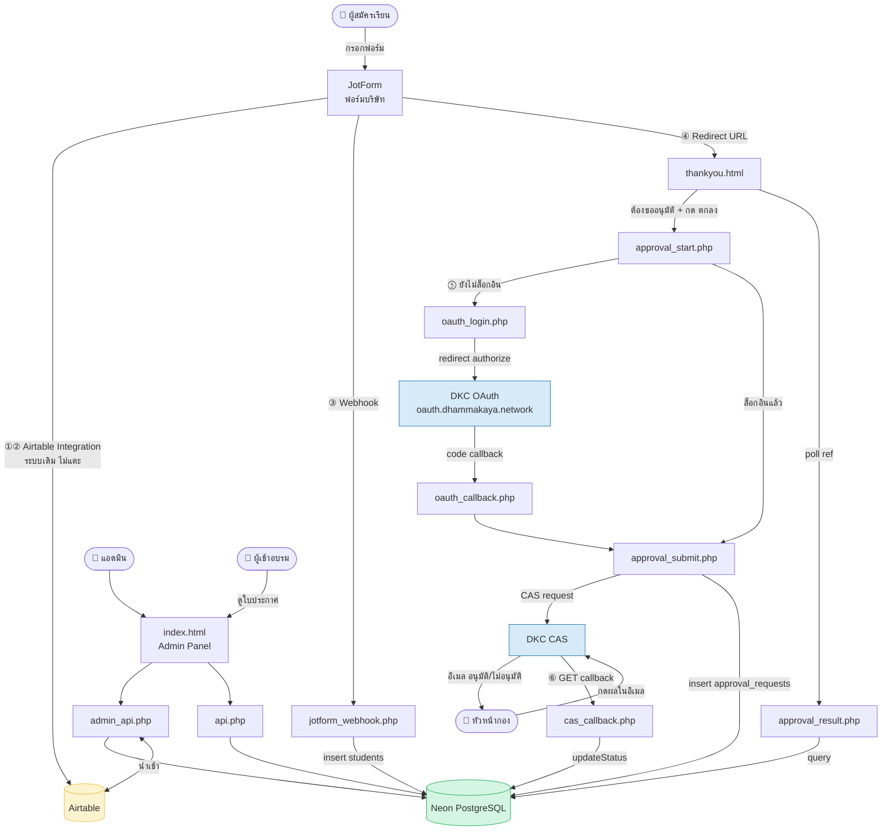
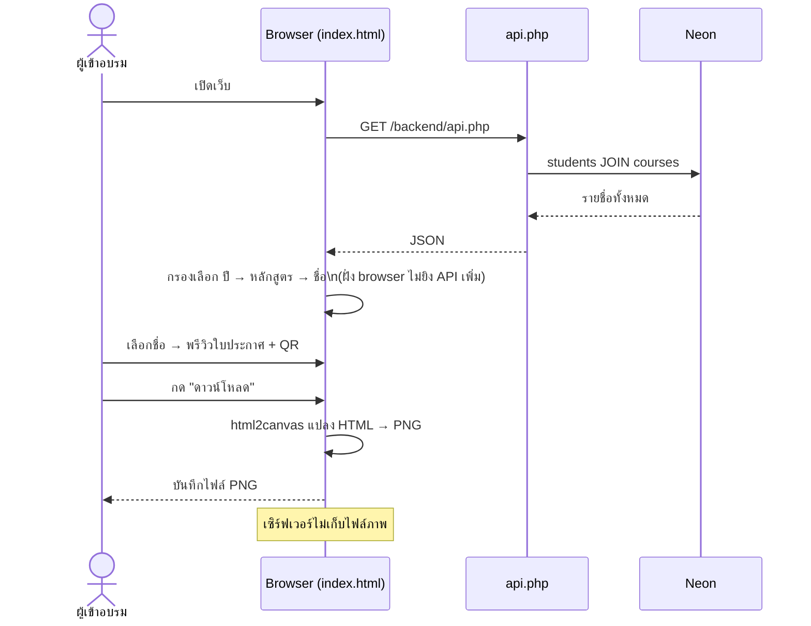
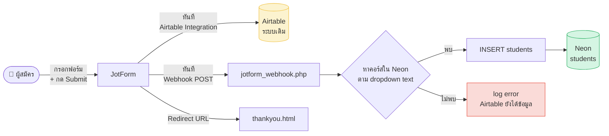
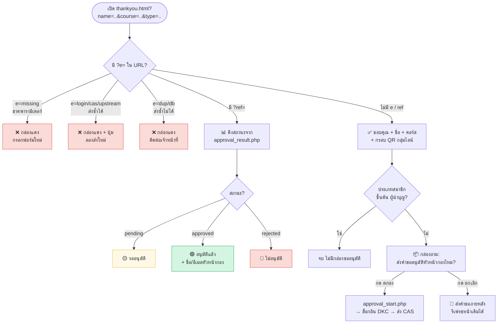
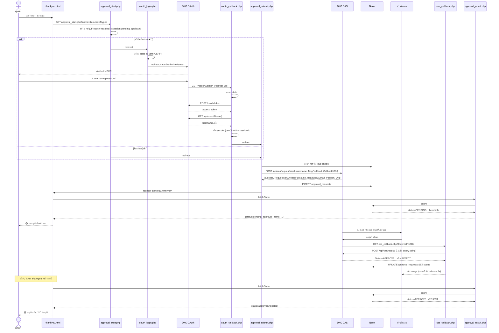

# ระบบออกใบประกาศนียบัตร + รับสมัครอบรม + ขออนุมัติหัวหน้ากอง
**ศูนย์อบรมคอมพิวเตอร์ วัดพระธรรมกาย**

เว็บไซต์ใช้งานจริง: https://comtrain-webcertificate.onrender.com/

เอกสารนี้เขียนให้ **ทีมที่จะมาพัฒนาต่อ** อ่านแล้วเข้าใจทั้งระบบ: แต่ละส่วนทำอะไร ข้อมูลไหลจากไหนไปไหน เก็บที่ไหน ตั้งค่าอะไรไว้ที่ไหน และถ้าจะแก้ต้องแก้ตรงไหน

---

## สารบัญ
1. [ระบบนี้ทำอะไร](#1-ระบบนี้ทำอะไร)
2. [แผนที่ระบบทั้งหมด (ใครคุยกับใคร)](#2-แผนที่ระบบทั้งหมด-ใครคุยกับใคร)
3. [หลักการทำงานแต่ละระบบ](#3-หลักการทำงานแต่ละระบบ)
   - 3.1 ดาวน์โหลดใบประกาศ
   - 3.2 สมัครเรียนผ่าน JotForm → บันทึก Airtable + Neon
   - 3.3 หน้า Thank you ทำงานอย่างไร
   - 3.4 ระบบขออนุมัติหัวหน้ากอง (DKC OAuth + CAS)
   - 3.5 แอดมินดูสถานะคำขอ
   - 3.6 แอดมินจัดการข้อมูลและนำเข้าจาก Airtable
4. [เทคโนโลยีที่ใช้](#4-เทคโนโลยีที่ใช้)
5. [โครงสร้างไฟล์ + คำอธิบายทีละไฟล์](#5-โครงสร้างไฟล์--คำอธิบายทีละไฟล์)
6. [โครงสร้างฐานข้อมูล (Neon)](#6-โครงสร้างฐานข้อมูล-neon)
7. [รายการ Endpoint ทั้งหมด](#7-รายการ-endpoint-ทั้งหมด)
8. [การตั้งค่าระบบภายนอก (JotForm / DKC OAuth+CAS / Airtable)](#8-การตั้งค่าระบบภายนอก-jotform--dkc-oauthcas--airtable)
9. [Environment Variables](#9-environment-variables)
10. [รันบนเครื่องตัวเอง (Local Setup)](#10-รันบนเครื่องตัวเอง-local-setup)
11. [Deploy และเช็คลิสต์ก่อนเปิดใช้จริง](#11-deploy-และเช็คลิสต์ก่อนเปิดใช้จริง)
12. [ความปลอดภัย](#12-ความปลอดภัย)
13. [คู่มือสำหรับนักพัฒนา: อยากแก้เรื่องนี้ ต้องแก้ตรงไหน](#13-คู่มือสำหรับนักพัฒนา-อยากแก้เรื่องนี้-ต้องแก้ตรงไหน)
14. [ข้อจำกัดและการตัดสินใจที่ผ่านมา](#14-ข้อจำกัดและการตัดสินใจที่ผ่านมา)
15. [ปัญหาที่เคยเจอ และวิธีแก้ (Troubleshooting)](#15-ปัญหาที่เคยเจอ-และวิธีแก้-troubleshooting)
16. [ประวัติการพัฒนา](#16-ประวัติการพัฒนา)
17. [สถานะปัจจุบันและงานที่เหลือ](#17-สถานะปัจจุบันและงานที่เหลือ)

---

## 1. ระบบนี้ทำอะไร

มี 4 บทบาทผู้ใช้:

| ผู้ใช้ | ทำอะไร | ผ่านหน้าไหน |
|---|---|---|
| **ผู้เข้าอบรม** (ทั่วไป ไม่ต้องล็อกอิน) | เลือกปี → หลักสูตร → ชื่อตัวเอง แล้วดาวน์โหลดใบประกาศเป็นรูป PNG (มี QR Code สำหรับตรวจสอบ) | `index.html` (หน้าแรก) |
| **ผู้สมัครเรียนใหม่** | กรอกฟอร์ม JotForm ของบริษัท → เห็นหน้า "ขอบคุณ" + QR กลุ่มไลน์ → (ถ้ามีบัญชี AD) เลือกส่งคำขออนุมัติถึงหัวหน้ากอง | JotForm → `thankyou.html` |
| **หัวหน้ากอง** | ได้อีเมลจากระบบ CAS ของ DKC แล้วกด "อนุมัติ / ไม่อนุมัติ" | อีเมล / ระบบ CAS (ไม่ใช่เว็บนี้) |
| **เจ้าหน้าที่ (แอดมิน)** | จัดการหลักสูตร/รายชื่อผู้เรียน, ดูสถานะคำขออนุมัติทั้งหมด, นำเข้าข้อมูลจาก Airtable | `index.html` → แท็บแอดมิน (ต้องล็อกอิน) |

**แนวคิดสำคัญ 3 ข้อ** (ถ้าจำได้แค่นี้ ก็เข้าใจครึ่งหนึ่งของระบบแล้ว)
1. **Dual-write:** ข้อมูลผู้สมัครเข้า **2 ที่พร้อมกัน** — Airtable ของบริษัท (ระบบเดิม ไม่แตะ) และ Neon (ฐานข้อมูลของเว็บนี้) ผ่าน Webhook
2. **การอนุมัติเป็นเพียง "การติดตามสถานะ"** — ผลอนุมัติ/ไม่อนุมัติไม่ส่งผลต่อการสมัคร ข้อมูลผู้เรียน หรือการออกใบประกาศ และผู้สมัครเลือก "ไม่ส่งคำขอ" ได้
3. **เว็บนี้ล็อกอิน DKC และคุยกับ CAS เอง** — ไม่พึ่ง DKC Portal (Cloudflare Worker) ตัวเดิมอีกแล้ว สถานะคำขอทั้งหมดอยู่ใน Neon

---

## 2. แผนที่ระบบทั้งหมด (ใครคุยกับใคร)



**ลำดับเหตุการณ์ตอนมีคนสมัคร** (ตัวเลขตรงกับในแผนภาพ)
1. ผู้สมัครกรอกฟอร์มแล้วกด Submit
2. JotForm บันทึกเข้า Airtable ตาม integration เดิม (ไม่เกี่ยวกับเว็บนี้)
3. JotForm ยิง Webhook ไป `backend/jotform_webhook.php` → เว็บนี้บันทึกลง Neon ตาราง `students`
4. JotForm พาผู้สมัครไป `thankyou.html?name=…&course=…&type=…` (ทำพร้อมกับข้อ 3 แต่เป็นอิสระต่อกัน)
5. ถ้าประเภทสมาชิกต้องขออนุมัติ และผู้สมัครกด **ตกลง** → เว็บพาไปล็อกอิน DKC แล้วส่งคำขอไป CAS
6. หัวหน้ากองกดอนุมัติ/ไม่อนุมัติ → CAS เรียก `cas_callback.php` กลับมา → เว็บอัปเดตสถานะใน Neon

> ข้อ 3 กับข้อ 4 **ไม่ขึ้นต่อกัน** ถ้า Webhook ล้มเหลว (เช่น หาคอร์สไม่เจอ) ผู้สมัครก็ยังเห็นหน้า Thank you ปกติ และ Airtable ยังได้ข้อมูลครบ

---

## 3. หลักการทำงานแต่ละระบบ

### 3.1 ดาวน์โหลดใบประกาศ



### 3.2 สมัครเรียนผ่าน JotForm → บันทึก Airtable + Neon (Dual-write)



> ⚠️ **ชื่อคอร์สใน dropdown ต้องตรงกับ `courses.long_key` (หรือ `short_name`) ทุกตัวอักษร** ถ้าไม่ตรง webhook จะตกไป log และ Neon จะไม่มีข้อมูล (Airtable ยังครบ) — แก้ด้วยการสร้างคอร์สให้ชื่อตรง แล้วใช้เมนู "นำเข้าข้อมูลจาก Airtable"
**จุดที่ต้องรู้**
- **ชื่อคอร์สใน dropdown ของ JotForm ต้องตรงกับ `courses.long_key` (หรือ `short_name`) ใน Neon ทุกตัวอักษร** ไม่งั้น webhook จะหาไม่เจอ
- ระบบ **ไม่สร้างคอร์สให้อัตโนมัติ** (เจตนา เพื่อให้ข้อมูลคอร์สสะอาด) ถ้าตกหล่น ให้แอดมินสร้างคอร์สให้ตรงชื่อ แล้วใช้เมนู "นำเข้าข้อมูลจาก Airtable" ดึงรายชื่อย้อนหลัง (§3.6)
- แอดมินยังเพิ่ม/แก้ตัวเลือกคอร์สที่ **JotForm โดยตรง** เหมือนเดิม (เมนู "เปิดรับสมัคร"/Sync ในเว็บยังมีโค้ดแต่ไม่ได้ใช้กับฟอร์มบริษัท)

### 3.3 หน้า Thank you ทำงานอย่างไร (`thankyou.html`)

JotForm ตั้งให้ redirect มาที่หน้านี้พร้อมพารามิเตอร์ (ดู §8.1):
`thankyou.html?name=<ชื่อ นามสกุล>&course=<คอร์ส>&type=<ประเภทสมาชิก>`

หน้านี้เป็นไฟล์เดียว (HTML+CSS+JS) **เสมอจะแสดงส่วนหลัก** คือ "ขอบคุณ" ตัวใหญ่ + ชื่อ + หลักสูตร + กรอบ QR Code กลุ่มไลน์ (`assets/images/line-qr.png` ถ้าไม่มีไฟล์จะเป็นกรอบสีเทา) แล้วเพิ่ม **กล่องขออนุมัติ** ตามสถานะ:


- กฎ "ต้องขออนุมัติหรือไม่" ตัดสินที่ `thankyou.html`: ประเภทที่ **ไม่ใช่** "ผู้นำบุญ สาธุชนทั่วไป อื่น ๆ" ถือว่ามีบัญชี AD และมีกอง
- ข้อความจาก URL แสดงด้วย `textContent` เท่านั้น (กัน XSS) และจำกัดความยาว (ชื่อ 100 / คอร์ส 200 / ประเภท 100)
- **ผู้สมัครไม่ถูกบังคับส่งคำขอ** กด "ยกเลิก" แล้วกลับมาส่งภายหลังได้ (รีเฟรชหน้าเดิมก็จะเห็นกล่องถามอีก)
- รหัสผิดพลาด `e` ดู §3.4 ตารางท้ายหัวข้อ

### 3.4 ระบบขออนุมัติหัวหน้ากอง (DKC OAuth + CAS)

**คำศัพท์**
- **DKC OAuth** (`oauth.dhammakaya.network`) — ระบบล็อกอินกลางของ DKC ใช้ยืนยันว่าผู้ใช้คือบัญชี AD ไหน (`username`)
- **CAS** — ระบบอนุมัติของ DKC เว็บเราส่ง "คำขอ" ไป CAS แล้ว CAS **หาหัวหน้ากองของผู้ขอเอง** ส่งอีเมลหาหัวหน้า และเรียก callback กลับเมื่อหัวหน้ากดผล
- **ผู้ขอ (requester)** = บัญชี AD ที่ล็อกอินตอนกด "ตกลง" (ไม่ใช่ชื่อที่กรอกในฟอร์ม)
- **ExternalRefID / `ref`** = รหัสคำขอที่เว็บเราสร้าง รูปแบบ `JF-<epoch ms>-<hex 8 ตัว>` ใช้เป็น primary key ใน Neon และเป็นรหัสอ้างอิงกับ CAS

#### ลำดับการทำงานเต็ม (Sequence)



#### รายละเอียดสำคัญของแต่ละขั้น
| ขั้น | ไฟล์ | สิ่งที่ทำและเหตุผล |
|---|---|---|
| เริ่ม | `approval_start.php` | สร้าง `ref` ฝั่ง server เก็บข้อมูลคำขอไว้ใน **session** (ไม่ใส่ใน URL ตอนไปล็อกอิน) ถ้าล็อกอินแล้วข้ามไปส่งเลย |
| ล็อกอิน | `oauth_login.php` | สร้าง `state` สุ่ม 32 ตัวอักษร hex กัน CSRF แล้วส่งไป `/oauth/authorize` |
| รับกลับ | `oauth_callback.php` | **ต้องตรงกับ redirect_uri ที่ลงทะเบียนกับ IT ทุกตัวอักษร** ตรวจ `state`, แลก token, ดึง `username` เก็บเฉพาะ username + ชื่อ ไม่เก็บ access token, เปลี่ยน session id (กัน session fixation) |
| ส่งคำขอ | `approval_submit.php` | กันส่งซ้ำด้วย `ref`; เรียก CAS; **บันทึก Neon เฉพาะเมื่อ CAS รับสำเร็จ** ถ้า CAS ล้มเหลวจะเก็บ `pending` ไว้ให้กด "ลองส่งใหม่" ถ้า CAS รับแล้วแต่บันทึก Neon พลาด → `e=db` (ไม่ให้ส่งซ้ำ เพราะหัวหน้าได้อีเมลไปแล้ว) |
| รับผล | `cas_callback.php` | **ไม่เชื่อสถานะใน query string** (ปลอมได้) ต้องถาม CAS ซ้ำ (`reqstat`) แล้วอัปเดต Neon ตามผลจริง ไม่ต้องล็อกอิน (CAS เป็นคนเรียก) |
| แสดงผล | `approval_result.php` | thankyou.html ถามด้วย `ref` ตอบเฉพาะ สถานะ + ข้อมูลหัวหน้ากอง ไม่ส่งข้อมูลผู้สมัครกลับ |

#### สถานะของคำขอ
| ค่าใน Neon (`status`) | ความหมาย | ที่แสดง |
|---|---|---|
| `PENDING` | รอหัวหน้ากอง | รออนุมัติ (สีเหลือง) |
| `APPROVE…` | หัวหน้ากองอนุมัติ | อนุมัติแล้ว (สีเขียว) |
| `REJECT…` | หัวหน้ากองไม่อนุมัติ | ไม่อนุมัติ (สีแดง) |

`ApprovalRepository::statusKind()` แปลงค่าดิบจาก CAS เป็น `pending` / `approved` / `rejected` ด้วยการดูขึ้นต้นข้อความ (ขึ้นต้น `APPROVE` / `REJECT` นอกนั้นเป็น pending)

#### ข้อความที่ส่งถึงหัวหน้ากอง
สร้างโดย `backend/lib/ApprovalMessage.php` (ใช้ร่วมกับ `approval_submit.php`)
- **หัวข้อ:** `ขออนุมัติสมัครอบรม: [ชื่อคอร์ส]`
- **ข้อความธรรมดา:** `ระบบสมัครอบรมคอมพิวเตอร์` ขึ้นบรรทัดใหม่ แล้ว `ขออนุมัติให้ [ชื่อ นามสกุล] เข้าอบรมหลักสูตร [คอร์ส]` (ข้อความนี้เก็บลง Neon คอลัมน์ `message` เสมอ)
- **โหมด HTML** (ตั้ง `CAS_MSG_HTML=1` บน Render): หัวเรื่องสีน้ำเงินมีเส้นใต้ + ตาราง "ผู้สมัคร / หลักสูตร" **ทุกค่า escape ด้วย `htmlspecialchars`** เพราะชื่อ/คอร์สมาจากสิ่งที่ผู้ใช้กรอก (กันแทรกโค้ดเข้าอีเมลหัวหน้ากอง) ปิดโหมดได้โดยลบตัวแปร — ทดสอบแล้วว่า CAS แสดง HTML ได้
- ปุ่ม อนุมัติ/ไม่อนุมัติ ในอีเมล **CAS เติมเอง** ไม่ได้มาจากเรา
- `ApproveType` = `1` (อนุมัติโดยหัวหน้ากอง) กำหนดใน `approval_submit.php`

#### รหัสผิดพลาดบนหน้า Thank you (`?e=`)
| รหัส | ความหมาย | ปุ่ม "ลองส่งใหม่" |
|---|---|---|
| `missing` | ชื่อ/คอร์ส/ประเภทไม่ครบ หรือไม่มี session | ไม่มี (ให้กรอกฟอร์มใหม่) |
| `login` | ล็อกอิน DKC ไม่สำเร็จ / state ไม่ตรง / ผู้ใช้ไม่อนุญาต / ตั้งค่า OAUTH_* ไม่ครบ | มี |
| `cas` | CAS ไม่รับคำขอ (เช่น หา AD/หัวหน้ากองไม่พบ, client ไม่มีสิทธิ์) | มี |
| `upstream` | CAS ไม่ตอบ / ตอบผิดรูปแบบ | มี |
| `dup` | `ref` นี้ถูกใช้โดยผู้ใช้คนอื่นแล้ว | ไม่มี |
| `db` | CAS รับคำขอแล้ว แต่บันทึก Neon ไม่สำเร็จ | ไม่มี (ติดต่อเจ้าหน้าที่พร้อมรหัสอ้างอิง) |

#### Session 2 ชุดที่แยกกัน
| Session | ชื่อคุกกี้ | ใช้กับ | เก็บอะไร |
|---|---|---|---|
| แอดมิน | `PHPSESSID` (ค่าเริ่มต้นของ PHP) | `auth.php`, `require_admin.php` | `is_admin` |
| ผู้ใช้ DKC | `DKCUSER` (`user_session.php`) | `approval_*`, `oauth_*` | `user` (username, ชื่อ), `pending` (ref/name/course/type), `applicant`, `oauth_state` |

คุกกี้ `DKCUSER` ตั้ง `HttpOnly`, `SameSite=Lax` (**ต้องเป็น Lax** เพื่อให้คุกกี้ติดมาตอน DKC redirect กลับ), `Secure` เมื่อเป็น HTTPS (ตรวจจาก `X-Forwarded-Proto` ของ Render), strict mode เปิด

### 3.5 แอดมินดูสถานะคำขอ

```
แอดมิน เปิดแท็บ "คำขออนุมัติ"
   └─▶ admin.js → fetchApprovals() (ค้นหาแบบ debounce, แบ่งหน้าละ 20)
        └─▶ backend/admin_api.php?action=list_approval_requests&page=&status=&q=
             └─▶ ApprovalRepository::listPage()  ──▶ Neon.approval_requests
        ◀── { items, total, page, per_page, summary:{total, approved, rejected, pending} }
   แสดง: วันที่ขอ | ผู้สมัคร | คอร์ส | ประเภท | ผู้ขอ (AD) | หัวหน้ากอง | สถานะ | อัปเดตล่าสุด
```
- เวลาเก็บเป็น **UTC** ใน Neon; `listPage()` ส่งออกด้วย `to_char` แล้ว `admin.js (formatThaiDateTime)` แปลงเป็นเวลาไทย
- กรองสถานะ: ทั้งหมด / รออนุมัติ / อนุมัติแล้ว / ไม่อนุมัติ และค้นหาจากชื่อ/คอร์ส/ผู้ขอ/หัวหน้ากอง
- `ApprovalRepository::insert()/updateStatus()` พยายาม **เดาผูก `student_id`** กับผู้เรียนใน Neon ด้วยชื่อ+คอร์ส (best-effort อาจว่างหรือผิดได้ถ้าชื่อซ้ำ)

### 3.6 แอดมินจัดการข้อมูลและนำเข้าจาก Airtable

**ล็อกอินแอดมิน:** `auth.js` → `backend/auth.php` (`action=login/logout/check`) เทียบกับ `ADMIN_USER`/`ADMIN_PASS` ใน env → ตั้ง `$_SESSION['is_admin']` (ผิดจะ `sleep(1)` กัน brute force) ทุก endpoint ของแอดมินเรียก `require_admin.php` ซึ่งตอบ 403 ถ้าไม่ได้ล็อกอิน

**จัดการข้อมูล:** `admin.js` → `admin_api.php` (list/add/update/delete ของคอร์สและผู้เรียน, ค้นหา/กรอง/เรียงลำดับ/แบ่งหน้า — คอลัมน์ที่เรียงได้มี whitelist กัน SQL injection ผ่าน `ORDER BY`)

**นำเข้าจาก Airtable** (ทั้งข้อมูลเก่าและรายการที่ webhook ตกหล่น):
```
[แอดมิน] กด "ดึงข้อมูลจาก Airtable"
   → airtable_preview: AirtableClient::fetchAllRecords() (วน pagination ครั้งละ 100 จนครบ)
   → ดึง courses ทั้งหมดจาก Neon ครั้งเดียว ทำ map ใน PHP (ไม่ query ทีละ record)
   → จัดกลุ่มตามชื่อคอร์ส (field "โปรแกรมที่สมัคร") แยก "คอร์สใหม่" / "คอร์สที่มีอยู่แล้ว"
[แอดมิน] กด "สร้างคอร์ส + นำเข้า" / "นำเข้านักเรียน" → เลือกรายชื่อ
   → airtable_import_course (transaction เดียว):
       1) สร้างคอร์สถ้าจำเป็น  2) ดึง Airtable ใหม่ (verify ฝั่ง server)  3) insert ทีละคน
       → commit หรือ rollback ถ้าพัง
```
`students.airtable_id` ใช้กันนำเข้าซ้ำ (แถวที่มาจาก webhook จะเป็น `NULL`)

---

## 4. เทคโนโลยีที่ใช้

| ส่วน | เทคโนโลยี | หน้าที่ |
|---|---|---|
| Frontend | HTML + CSS + Vanilla JavaScript (แยกไฟล์ตามหน้าที่) | หน้าดาวน์โหลดใบประกาศ, Admin Panel, หน้า Thank you |
| สร้างภาพใบประกาศ | [html2canvas](https://html2canvas.hertzen.com/) | แปลง HTML เป็น PNG ในเบราว์เซอร์ |
| QR Code | [qrcodejs](https://github.com/davidshimjs/qrcodejs) | QR บนใบประกาศ |
| Backend | PHP 8.2 (ไม่ใช้ framework, PDO ตรง ๆ, cURL) | API ทั้งหมด แบ่ง endpoint + repository |
| Database | [Neon](https://neon.tech) PostgreSQL (Serverless) | ข้อมูลหลักสูตร ผู้เรียน และคำขออนุมัติ |
| Hosting | [Render](https://render.com) Web Service แบบ Docker (แผนฟรี) | รันเว็บ PHP |
| Container | Docker (`php:8.2-apache` + `pdo_pgsql`) | กำหนด environment |
| รับสมัคร | JotForm (ฟอร์มบริษัท `231301336713444`) | ฟอร์มสมัคร + Webhook + Thank You redirect |
| ระบบเดิมของบริษัท | Airtable (REST API) | เก็บข้อมูลสมัครเดิม + แหล่งนำเข้าย้อนหลัง |
| ล็อกอิน | DKC OAuth (`oauth.dhammakaya.network`) | ยืนยันบัญชี AD ของผู้ขออนุมัติ |
| ขออนุมัติ | DKC CAS (ที่เดียวกับ OAuth) | ส่งอีเมลหาหัวหน้ากอง + callback ผลอนุมัติ |
| Keep-alive | UptimeRobot | ปิงเว็บทุก 5 นาที กัน Render หลับหลัง idle 15 นาที |

---

## 5. โครงสร้างไฟล์ + คำอธิบายทีละไฟล์

```
webcertificate/
│   Dockerfile
│   index.html                หน้าแรก + Admin Panel (markup ล้วน)
│   thankyou.html             หน้า Thank you (ไฟล์เดียว มี CSS/JS ในตัว)
│   README.md
│   .env                      (เฉพาะเครื่อง local — ห้าม commit)
│
├── assets/
│   ├── css/style.css
│   ├── docs/architecture-diagram.png   ภาพสถาปัตยกรรมเดิม (เฉพาะส่วนใบประกาศ/JotForm/Airtable)
│   ├── images/ logo.png, main1.png, line-qr.png (QR กลุ่มไลน์ — วางไฟล์จริงทับได้)
│   └── js/ admin.js, auth.js, certificate.js
│
├── backend/
│   ├── api.php                  ข้อมูลผู้เรียนสำหรับหน้าสาธารณะ
│   ├── auth.php                 ล็อกอิน/ออกจากระบบแอดมิน
│   ├── admin_api.php            CRUD + Airtable import + รายการคำขออนุมัติ (ต้องเป็นแอดมิน)
│   ├── active_courses.php       เปิด/ปิดรับสมัคร + Sync JotForm (ไม่ได้ใช้จริงกับฟอร์มบริษัท)
│   ├── jotform_webhook.php      รับ Webhook จาก JotForm → Neon
│   ├── approval_start.php       เริ่มขอ: สร้าง ref เก็บ session แล้วไปล็อกอิน/ส่ง
│   ├── oauth_login.php          เริ่มล็อกอิน DKC (สร้าง state)
│   ├── oauth_callback.php       redirect_uri ของ DKC OAuth
│   ├── approval_submit.php      ส่งคำขอไป CAS + บันทึก Neon
│   ├── cas_callback.php         CallbackURL ที่ CAS เรียกกลับเมื่อหัวหน้ากองกดผล
│   ├── approval_result.php      ผลคำขอให้หน้า Thank you (สาธารณะ ตาม ref)
│   └── lib/
│       ├── load_env.php, require_admin.php, error_handler.php
│       ├── AirtableClient.php, CourseRepository.php, StudentRepository.php
│       ├── ApprovalRepository.php   ตาราง approval_requests
│       ├── ApprovalMessage.php      สร้างข้อความถึงหัวหน้ากอง (ธรรมดา/HTML)
│       ├── DkcOAuth.php             ตัวเชื่อม DKC OAuth
│       ├── CasClient.php            ตัวเชื่อม CAS
│       └── user_session.php         session ผู้ใช้ DKC + ตัวช่วย redirect
│
└── database/
    ├── schema.sql               สร้างตารางทั้งหมด (รวม approval_requests)
    ├── approval_requests.sql    สร้างเฉพาะตารางคำขอ (รันได้ครั้งเดียวบน DB ที่มีตารางอื่นแล้ว)
    ├── seed.sql                 ข้อมูลตัวอย่าง (สมมติทั้งหมด)
    └── config.php               getDB() อ่านค่าจาก env
```

### ราก / Frontend
| ไฟล์ | หน้าที่ |
|---|---|
| `Dockerfile` | `php:8.2-apache` + `pdo_pgsql`, คัดลอกโค้ดเข้า `/var/www/html`, ให้ Apache ฟังพอร์ต `PORT` ที่ Render กำหนด |
| `index.html` | markup ของหน้าดาวน์โหลดใบประกาศ + Admin Panel (3 แท็บ: ดาวน์โหลด / จัดการข้อมูล / คำขออนุมัติ) ไม่มี CSS/JS ฝัง |
| `thankyou.html` | หน้า Thank you ตามเงื่อนไขใน §3.3 |
| `assets/js/certificate.js` | โหลดข้อมูลจาก `api.php`, dropdown ปี/คอร์ส/ชื่อ, พรีวิว, QR, ดาวน์โหลด PNG |
| `assets/js/auth.js` | modal ล็อกอิน/ออกจากระบบแอดมิน, เก็บสถานะใน `sessionStorage`, แสดง/ซ่อนแท็บแอดมิน |
| `assets/js/admin.js` | ตรรกะแอดมินทั้งหมด: ตารางคอร์ส/ผู้เรียน, modal เพิ่ม-แก้ไข, เปิดรับสมัคร, นำเข้า Airtable, แท็บคำขออนุมัติ (`loadApprovalsPage`, `fetchApprovals`, `formatThaiDateTime`) |
| `assets/css/style.css` | สไตล์ทั้งหมดของ `index.html` |

### Backend — endpoint
| ไฟล์ | หน้าที่ |
|---|---|
| `api.php` | สาธารณะ: คืนรายชื่อผู้เรียนทั้งหมดพร้อมคอร์สผ่าน `StudentRepository::listAllWithCourse()` |
| `auth.php` | `action=login/logout/check` ตั้ง `$_SESSION['is_admin']` |
| `admin_api.php` | แอดมินเท่านั้น (ผ่าน `require_admin.php`) ดูตาราง action ใน §7 |
| `active_courses.php` | แอดมินเท่านั้น: `list`, `toggle`, `sync_jotform` (ส่งชื่อยาวของคอร์สที่เปิดไป JotForm API) — เก็บไว้เผื่ออนาคต |
| `jotform_webhook.php` | สาธารณะ (JotForm เรียก): แกะ `rawRequest` → หา course → insert `students` |
| `approval_start.php` | รับ `name/course/type` → สร้าง `ref` → เก็บ session → ไป `oauth_login.php` หรือ `approval_submit.php` |
| `oauth_login.php` | สร้าง `state` แล้ว redirect ไป `/oauth/authorize` |
| `oauth_callback.php` | ตรวจ state, แลก token, ดึง username, เก็บ session → `approval_submit.php` |
| `approval_submit.php` | ส่ง CAS + บันทึก Neon + redirect กลับ thankyou |
| `cas_callback.php` | CAS เรียก → ถาม reqstat → อัปเดต Neon → แสดงหน้าผลให้หัวหน้ากอง |
| `approval_result.php` | สาธารณะ: `?ref=` ต้องตรง `^JF-\d{10,14}-[a-f0-9]{8}$` ตอบ `found`, `status`, `approver_name`, `approver_email`, `approver_position`, `approver_org` (ไม่ส่งข้อมูลผู้สมัคร) |

### Backend — `lib/`
| ไฟล์ | หน้าที่ |
|---|---|
| `load_env.php` | โหลด `.env` บนเครื่อง local (บน Render ข้าม) ทุก endpoint `require_once` ไว้บนสุด |
| `require_admin.php` | middleware: เริ่ม session, ตั้ง header JSON, ตอบ 403 ถ้าไม่ใช่แอดมิน |
| `error_handler.php` | `send_error_response()` log รายละเอียดฝั่ง server แต่ส่งข้อความทั่วไปให้ client |
| `AirtableClient.php` | ดึง records ทุกหน้าของ Airtable table ที่กำหนด |
| `CourseRepository.php` | SQL ของ `courses`/`active_courses`: `listWithStudentCount`, `listWithActiveFlag`, `listActiveLongKeys`, `findByShortName`, `findByShortNameOrLongKey`, `add/update/delete`, `activate/deactivate` |
| `StudentRepository.php` | SQL ของ `students`: `paginate`, `find`, `add/update/delete`, `insertFromWebhook`, `insertFromAirtable`, `listAllWithCourse`, ตัวช่วยกันนำเข้าซ้ำ |
| `ApprovalRepository.php` | SQL ของ `approval_requests`: `statusKind`, `find`, `insert` (ON CONFLICT DO NOTHING), `updateStatus`, `findStudentId`, `listPage` |
| `ApprovalMessage.php` | `ApprovalMessage::build($name,$course)` → `['plain'=>…, 'html'=>…]` |
| `DkcOAuth.php` | `fromEnv()`, `authorizeUrl($state)`, `exchangeCode($code)`, `fetchUser($token)` (ต้องมี `username`) |
| `CasClient.php` | `fromEnv()`, `sendRequest(…)`, `fetchStatus($ref)`, `isOk($r)` |
| `user_session.php` | `user_session_start()`, `dkc_app_url()`, `dkc_redirect()`, `dkc_redirect_thankyou()` (แนบ name/course/type จาก session), `dkc_clip()` |

### Database
| ไฟล์ | หน้าที่ |
|---|---|
| `database/config.php` | `getDB()` PDO singleton (SSL `require` — ใช้กับ Neon; ถ้าต่อ Postgres local ที่ไม่มี SSL ต้องปรับ `sslmode`) |
| `database/schema.sql` | สร้างตารางทั้งหมด |
| `database/approval_requests.sql` | สร้างเฉพาะ `approval_requests` + index |
| `database/seed.sql` | ข้อมูลตัวอย่างสมมติ |

---

## 6. โครงสร้างฐานข้อมูล (Neon)

```
courses 1 ───────< students            (students.course_id → courses.id, ON DELETE CASCADE)
courses 1 ──── 0..1 active_courses     (active_courses.course_id → courses.id, ON DELETE CASCADE)
students 1 ──── 0..* approval_requests (approval_requests.student_id → students.id, ON DELETE SET NULL, ว่างได้)
```

### `courses`
| คอลัมน์ | ความหมาย |
|---|---|
| `id` | PK (SERIAL) |
| `long_key` | **ชื่อยาว ห้ามซ้ำ (UNIQUE)** — ชื่อคอร์ส+วันที่อบรม ใช้เทียบกับ dropdown ของ JotForm และ field "โปรแกรมที่สมัคร" ใน Airtable |
| `short_name` | ชื่อย่อ (อ้างอิงเสริม; webhook เทียบได้ทั้งชื่อย่อและชื่อยาว) |
| `training_date` | ข้อความวันที่อบรม |
| `year_be` | ปี พ.ศ. 4 หลัก ใช้กรอง |
| `verify_url` | ปลายทางของ QR บนใบประกาศ |
| `created_at` | เวลาสร้าง |

### `students`
ผู้เรียน 1 แถว = 1 คน ผูกคอร์สด้วย `course_id` (NOT NULL) ฟิลด์: `first_name`, `last_name`, `member_type`, `apply_date`, `birth_date`, `age`, `royal_title`, `education_level`, `faculty`, `major`, `institution`, `department`, `office`, `position`, `phone_internal`, `phone_mobile`, `email`, `head_status`, `attendance`, `last_modified_time`, `airtable_id` (กันนำเข้าซ้ำ; `NULL` ถ้ามาจาก webhook), `created_at`
> ฟอร์มบริษัทไม่มีช่อง "พรรษา" แยกจาก "อายุ" และไม่มี "สถานะหัวหน้ากอง" สองคอลัมน์นี้จึงเป็น `NULL` จาก webhook

### `active_courses`
junction table เก็บ `course_id` ที่เปิดรับสมัคร (มีแถว = เปิด) ปัจจุบันไม่ได้ผูกกับ JotForm จริงแล้ว

### `approval_requests` (คำขออนุมัติ)
| คอลัมน์ | ความหมาย |
|---|---|
| `external_ref_id` | **PK** รหัส `JF-<epoch ms>-<hex8>` (= `ExternalRefID` ของ CAS) |
| `requester_ad` | บัญชี AD ผู้ขอ (คนที่ล็อกอิน) |
| `requester_name` | ชื่อที่แสดงของผู้ขอ |
| `applicant_name` | ชื่อ-นามสกุลผู้สมัครจากฟอร์ม |
| `course` | ชื่อคอร์สจากฟอร์ม (เก็บเป็นข้อความ ไม่ผูก FK — เปลี่ยนชื่อคอร์สภายหลังไม่กระทบแถวเก่า) |
| `member_type` | ประเภทสมาชิกจากฟอร์ม |
| `student_id` | FK → `students` (best-effort เดาด้วยชื่อ+คอร์ส ว่างได้) |
| `approve_type` | `1` = อนุมัติโดยหัวหน้ากอง |
| `subject`, `message` | หัวข้อ/ข้อความ (แบบธรรมดา) ที่ส่งถึงหัวหน้ากอง |
| `request_key` | `RequestKey` จาก CAS |
| `approver_ad`, `approver_name` | หัวหน้ากองที่ CAS หาให้ |
| `status` | `PENDING` / `APPROVE…` / `REJECT…` |
| `approve_step` | ขั้นอนุมัติจาก CAS |
| `cas_data` | JSON คำตอบของ CAS ตอนส่งคำขอ (มี `HeadShowEmail`, `Position`, `Organization` ที่หน้า Thank you ใช้แสดง) |
| `created_at`, `updated_at` | **UTC** (`now() AT TIME ZONE 'UTC'`) |

Index: `requester_ad`, `created_at DESC`, `status`, `student_id`

---

## 7. รายการ Endpoint ทั้งหมด

| Endpoint | ใครเรียก | ต้องล็อกอิน | หน้าที่ |
|---|---|---|---|
| `GET backend/api.php` | หน้าแรก | ไม่ | รายชื่อผู้เรียนทั้งหมด |
| `POST backend/auth.php` | หน้าแรก | — | login/logout/check แอดมิน |
| `* backend/admin_api.php?action=…` | Admin Panel | **แอดมิน** | ดูตารางด้านล่าง |
| `* backend/active_courses.php` | Admin Panel | **แอดมิน** | เปิด/ปิดรับสมัคร, sync JotForm (ไม่ใช้จริง) |
| `POST backend/jotform_webhook.php` | **JotForm** | ไม่ (สาธารณะ) | บันทึกผู้สมัครลง Neon |
| `GET backend/approval_start.php?name&course&type` | thankyou.html (ปุ่มตกลง) | ไม่ | เริ่มขออนุมัติ |
| `GET backend/oauth_login.php` | approval_start | ไม่ | ไป DKC OAuth |
| `GET backend/oauth_callback.php` | **DKC OAuth** | ไม่ | รับ code (redirect_uri) |
| `GET backend/approval_submit.php` | oauth_callback / ปุ่มลองใหม่ | ต้องมี session DKC | ส่งคำขอ CAS |
| `GET backend/cas_callback.php?ExternalRefID=` | **CAS** | ไม่ | รับผลอนุมัติ (ถามซ้ำก่อนเชื่อ) |
| `GET backend/approval_result.php?ref=` | thankyou.html | ไม่ (ต้องรู้ ref) | สถานะ + ข้อมูลหัวหน้ากอง |

**Action ของ `admin_api.php`**
| Action | หน้าที่ |
|---|---|
| `list_courses` | คอร์สทั้งหมด + จำนวนผู้เรียน |
| `add_course` / `update_course` / `delete_course` | จัดการหลักสูตร |
| `list_students` | ผู้เรียนแบบแบ่งหน้า (ค้นหา/กรองปี/คอร์ส/เรียง) |
| `get_student` / `add_student` / `update_student` / `delete_student` | จัดการผู้เรียน |
| `airtable_preview` | ดึง Airtable จัดกลุ่มตามคอร์ส เทียบกับ Neon |
| `airtable_import_course` | สร้างคอร์ส (ถ้าจำเป็น) + นำเข้านักเรียนที่เลือก ใน transaction เดียว |
| `list_approval_requests` | รายการคำขอ + สรุป (`page`, `per_page`, `status`, `q`) |

---

## 8. การตั้งค่าระบบภายนอก (JotForm / DKC OAuth+CAS / Airtable)

### 8.1 JotForm ฟอร์มบริษัท (`231301336713444`)

#### (ก) Webhook → บันทึกลง Neon
1. JotForm → เปิดฟอร์ม → **Settings → Integrations**
2. ตรวจว่า **Airtable** integration เดิมยังอยู่ (ห้ามแตะ)
3. เพิ่ม **Webhooks** ปลายทาง: `https://comtrain-webcertificate.onrender.com/backend/jotform_webhook.php`
4. ต้องเห็น 2 integrations พร้อมกัน (Airtable + Webhooks)

#### (ข) Field mapping (ที่ `jotform_webhook.php` ใช้แกะ `rawRequest`)
| ข้อมูล | field id | key ใน `rawRequest` |
|---|---|---|
| ชื่อ | 110 | `q110_typeA110` |
| นามสกุล (ฉายา) | 111 | `q111_input111` |
| ประเภทสมาชิกองค์กร | 17 | `q17_typeA` |
| อายุ / พรรษาที่ (รวมช่องเดียว) | 60 | `q60_input60` |
| ระดับการศึกษาสูงสุด | 61 | `q61_input61` |
| คณะ | 90 | `q90_input90` |
| สาขา | 79 | `q79_input79` |
| สถาบัน/โรงเรียน | 75 | `q75_input75` |
| สังกัดหน่วยงาน/กอง/ศูนย์ | 31 | `q31_typeA31` |
| สำนัก | 32 | `q32_input59` |
| ตำแหน่ง | 33 | `q33_typeA33` |
| เบอร์ภายใน | 38 | `q38_input38['full']` ⚠️ เป็น array (`control_phone`) |
| เบอร์มือถือ | 39 | `q39_phoneNumber['full']` |
| Email | 82 | `q82_email82` |
| วันเกิด | 98 | `q98_input98` (object year/month/day) |
| **โปรแกรมที่ต้องการสมัครเรียน (dropdown คอร์ส)** | 93 | `q93_input93` |
| วันที่ส่งแบบฟอร์ม | 9 | `q9_date` (object) |
| ค่าสมัครอบรม | 104 | `q104_input104` |

> ถ้า field id เปลี่ยน (เช่น โคลนฟอร์ม) ต้องแก้ใน `jotform_webhook.php` ดึง id จริงได้จาก `GET https://api.jotform.com/form/{formId}/questions?apiKey=...`

#### (ค) Thank You Page → เชื่อมกับหน้า Thank you ของเรา
**Settings → Thank You Page → Redirect to an external link after submission** ใส่ URL:
```
https://comtrain-webcertificate.onrender.com/thankyou.html?name={typeA110}%20{input111}&course={input93}&type={typeA}
```
- ตัวแปรในปีกกาคือ **Unique Name** ของฟิลด์: `typeA110` (ชื่อ), `input111` (นามสกุล), `input93` (คอร์ส), `typeA` (ประเภทสมาชิก) — ต้องตรวจให้ตรงกับฟอร์มที่ใช้ (Properties → Advanced → Unique Name)
- `%20` = ช่องว่างระหว่างชื่อกับนามสกุล
- **ไม่ต้องใช้ Conditions** (ถ้าเคยตั้ง "Change Thank You page" ให้ลบ มิฉะนั้นผู้สมัครจะข้ามหน้านี้)
- **ปิด "Send Post Data / Redirect with HTTP POST"** (ถ้าเปิด JotForm จะส่งแบบ POST ซึ่ง `thankyou.html` เป็นไฟล์สถิตรับไม่ได้)
- ประเภทสมาชิกที่ **ไม่ต้องขออนุมัติ** ต้องขึ้นต้นด้วยคำว่า "ผู้นำบุญ" (เช่น "ผู้นำบุญ สาธุชนทั่วไป อื่น ๆ") — ถ้าเปลี่ยนข้อความตัวเลือกในฟอร์ม ต้องแก้เงื่อนไขใน `thankyou.html` ด้วย
- ตั้ง/แก้ตอนไม่มีคนกรอกอยู่ และทดสอบ 2 กรณี: ประเภทผู้นำบุญ และประเภทอื่น

> ⚠️ ถ้าโคลนฟอร์มมาทดสอบ ให้ลบ Integrations (Airtable/Webhook) ที่ติดมาก่อน มิฉะนั้นข้อมูลทดสอบจะไหลเข้าระบบจริง

> **ข้อมูลที่ JotForm ส่งเมื่อเปิด "Send Post Data"** (ทดสอบแล้ว ไม่ได้ใช้ในระบบปัจจุบัน): มี `submission_id`, `formID`, และค่าฟิลด์เกือบทั้งหมด แต่ **ไม่มีลิงก์/hash ของไฟล์ PDF** ดูเหตุผลที่ §14

#### (ง) ฟอร์มทดลอง `261701468554460`
ใช้ทดสอบระบบขออนุมัติ มีคอร์สทดสอบ `TEST-ระบบขออนุมัติ` ใน dropdown และใน Neon ต้องถอด Webhook/Integration ออกหรือลบคอร์ส/ข้อมูลทดสอบก่อนปิดงาน (ดู §17)

### 8.2 DKC OAuth + CAS (ต้องประสานทีม IT ของ DKC)

| รายการ | ค่า | หมายเหตุ |
|---|---|---|
| Base URI | `https://oauth.dhammakaya.network` | `OAUTH_BASE_URI` |
| `client_id` / `client_secret` | ได้จาก IT | ใช้ทั้งล็อกอินและ CAS (แยกเป็น `CAS_CLIENT_*` ได้ถ้า IT ออกให้คนละชุด) |
| **redirect_uri** | `https://comtrain-webcertificate.onrender.com/backend/oauth_callback.php` | **ต้องลงทะเบียนกับ IT และตรงกันทุกตัวอักษร** ทั้งตอน authorize และตอนแลก token ถ้าย้ายโดเมนต้องแจ้ง IT |
| **CallbackURL ของ CAS** | `https://comtrain-webcertificate.onrender.com/backend/cas_callback.php` | เว็บเราส่งไปใน body ของทุกคำขอเอง (`APP_URL` + `/backend/cas_callback.php`) CAS ตอบกลับเป็น GET |

**API ที่ใช้**
| Endpoint | วิธี | ส่ง | ได้ |
|---|---|---|---|
| `/oauth/authorize` | redirect | `client_id`, `redirect_uri`, `state`, `response_type=code` | `code`, `state` กลับที่ redirect_uri |
| `/oauth/token` | POST | `code`, `client_id`, `client_secret`, `redirect_uri`, `grant_type` | `access_token` |
| `/api/user` | GET (Bearer) | — | `username` (บัญชี AD), ชื่อ |
| `/api/cas/request` | POST | `client_id`, `client_secret`, `ExternalRefID`, `ApproveType`, `MsgSubject`, `MsgForHead`, `Requester_ADUser`, `CallbackURL` | `success`, `data{RequestKey, ADApprover, HeadFullName, HeadShowEmail, Position, Organization}` |
| `/api/cas/reqstat` | POST | `client_id`, `ExternalRefID` | `Status`, `ApproveStep`, `Approver_ADUser` |

**แยกให้ชัด:** CAS **หาหัวหน้ากองเอง** จากบัญชีผู้ขอ — เว็บเราไม่ส่งชื่อหัวหน้า `HeadShowEmail` เป็นอีเมลที่ CAS ปิดบางส่วนมาแล้ว (เช่น `so****72@gmail.com`) เราแสดงตามที่ได้

### 8.3 Airtable
Base `appI37LT5wFrI4ITA` ใช้เป็นระบบเดิมของบริษัท และเป็นแหล่งนำเข้าย้อนหลัง อ่านด้วย Personal Access Token (`AIRTABLE_API_KEY`) field ที่ใช้จัดกลุ่มคอร์สคือ **"โปรแกรมที่สมัคร"** (ค่าคงที่ `AIRTABLE_COURSE_FIELD` ใน `admin_api.php`)

---

## 9. Environment Variables

ตั้งบน Render: Dashboard → service → **Environment** (หลัง Save จะ redeploy อัตโนมัติ) / บนเครื่อง local ใช้ไฟล์ `.env`

| ตัวแปร | จำเป็น | คำอธิบาย | ใช้ใน |
|---|---|---|---|
| `DB_HOST`, `DB_PORT`, `DB_NAME`, `DB_USER`, `DB_PASS` | ✅ | การเชื่อมต่อ Neon | `database/config.php` |
| `ADMIN_USER`, `ADMIN_PASS` | ✅ | ล็อกอินแอดมิน | `backend/auth.php` |
| `APP_URL` | ✅ | URL เว็บนี้ ไม่มี `/` ท้าย (ใช้ประกอบ redirect และ CallbackURL ของ CAS) | `user_session.php` |
| `OAUTH_BASE_URI` | ✅ | `https://oauth.dhammakaya.network` | `DkcOAuth.php`, `CasClient.php` |
| `OAUTH_CLIENT_ID`, `OAUTH_CLIENT_SECRET` | ✅ | ได้จาก IT (Secret) | เหมือนข้างบน |
| `OAUTH_REDIRECT_URI` | ✅ | `…/backend/oauth_callback.php` ต้องตรงที่ลงทะเบียน | `DkcOAuth.php` |
| `CAS_CLIENT_ID`, `CAS_CLIENT_SECRET` | ไม่บังคับ | ถ้า CAS ใช้คีย์คนละชุดกับล็อกอิน | `CasClient.php` |
| `CAS_REQUEST_URL`, `CAS_REQ_STATUS_URL` | ไม่บังคับ | override URL ของ CAS (ค่าเริ่มต้นต่อจาก `OAUTH_BASE_URI`) | `CasClient.php` |
| `CAS_MSG_HTML` | ไม่บังคับ | `1` = ส่งข้อความถึงหัวหน้ากองเป็น HTML; ไม่ตั้ง = ข้อความธรรมดา (**ตอนนี้ใช้ `1`**) | `approval_submit.php` |
| `AIRTABLE_API_KEY`, `AIRTABLE_BASE_ID`, `AIRTABLE_TABLE_ID` | สำหรับนำเข้า | Airtable | `admin_api.php` |
| `JOTFORM_API_KEY`, `JOTFORM_FORM_ID`, `JOTFORM_FIELD_ID` | ไม่ได้ใช้จริง | ฟีเจอร์ Sync JotForm (เก็บโค้ดไว้) | `active_courses.php` |

> ห้าม commit `.env` และห้ามวางค่า secret ในแชต/เอกสาร ถ้ารั่วให้เปลี่ยนค่าใหม่ทันที

---

## 10. รันบนเครื่องตัวเอง (Local Setup)

1. เตรียม PostgreSQL (Neon ฟรี หรือ Postgres ที่ติดตั้งเอง)
2. สร้างตาราง: `psql "postgresql://<user>:<pass>@<host>/<db>" -f database/schema.sql` (ข้อมูลตัวอย่างเพิ่มเติม: `-f database/seed.sql`)
3. สร้าง `.env` ที่ root โดยใส่ตัวแปรใน §9 (อย่างน้อย `DB_*`, `ADMIN_*`; ถ้าจะทดสอบขออนุมัติ ต้องมี `OAUTH_*` และ `APP_URL` เป็น `http://localhost:8000` และ redirect_uri ต้องลงทะเบียนกับ IT เพิ่ม หรือใช้ระบบจำลอง)
4. ตรวจ extension: `php -m | findstr pgsql` ต้องเห็น `pdo_pgsql`
5. Windows: ตั้ง `curl.cainfo` / `openssl.cafile` ใน `php.ini` ชี้ไฟล์ `cacert.pem` (จาก curl.se/ca/cacert.pem) ไม่งั้น cURL ต่อ Airtable/DKC ไม่ได้
6. รัน `php -S localhost:8000` แล้วเปิด `http://localhost:8000`
7. (ทางเลือก) Docker: `docker build -t webcertificate .` แล้ว `docker run -p 8080:10000 -e PORT=10000 --env-file .env webcertificate`

> `database/config.php` ใช้ `sslmode=require` (สำหรับ Neon) ถ้าต่อ Postgres local ที่ไม่มี SSL ต้องปรับชั่วคราว
> ทดสอบ flow ขออนุมัติโดยไม่ยิง DKC จริง: ทำ mock server จำลอง `/oauth/authorize`, `/oauth/token`, `/api/user`, `/api/cas/request`, `/api/cas/reqstat` แล้วตั้ง `OAUTH_BASE_URI` ไปที่ mock

---

## 11. Deploy และเช็คลิสต์ก่อนเปิดใช้จริง

**Deploy:** push ขึ้น GitHub `main` → Render build Dockerfile เอง (รอสถานะ **Live** ประมาณ 2–5 นาที) — ระวังตอนวางไฟล์ทับในเครื่อง: **วางทีละไฟล์ตามโฟลเดอร์ อย่าวางทับทั้งโฟลเดอร์** (ไฟล์ที่ไม่มีในชุดที่วางจะถูกลบ) และดู `git status` ก่อน commit ทุกครั้ง

**ตั้งระบบครั้งแรก (ทำแล้วสำหรับฟอร์มทดลอง)**
1. รัน `database/approval_requests.sql` ใน Neon SQL Editor (ครั้งเดียว; ใช้ `IF NOT EXISTS` รันซ้ำได้)
2. ตั้ง env ใน §9 บน Render
3. ให้ IT ลงทะเบียน redirect_uri และยืนยันว่า CAS รับ CallbackURL ใหม่
4. ตั้ง JotForm Thank You Page (§8.1ค)

**เช็คลิสต์เปิดใช้กับฟอร์มบริษัท**
- [ ] Unique Name ของฟอร์มบริษัทตรงกับ `typeA110`, `input111`, `input93`, `typeA`
- [ ] ตัวเลือกประเภทที่ไม่ต้องขออนุมัติขึ้นต้นด้วย "ผู้นำบุญ"
- [ ] ตั้ง Thank You Page เป็น redirect (ลิงก์ใน §8.1ค), ปิด Send Post Data, ลบ Thank You Conditions
- [ ] วางรูป QR จริงที่ `assets/images/line-qr.png`
- [ ] ทดสอบ 2 กรณี (ประเภทต้องขออนุมัติ / ผู้นำบุญ) — ระวัง: คำขอจะส่งอีเมลถึงหัวหน้ากองจริงของบัญชีที่ล็อกอิน และข้อมูลทดสอบเข้า Airtable+Neon จริง ต้องลบหลังทดสอบ
- [ ] เปลี่ยนคีย์ที่เคยรั่ว / ลบ Portal (§17)

---

## 12. ความปลอดภัย

| เรื่อง | มาตรการ |
|---|---|
| ล็อกอิน DKC | `state` สุ่ม ใช้ครั้งเดียว + `hash_equals`; เปลี่ยน session id หลังล็อกอิน; ไม่เก็บ access token; คุกกี้ HttpOnly/SameSite=Lax/Secure |
| ปลอมสถานะอนุมัติ | `cas_callback.php` ไม่เชื่อ query string ต้องถาม CAS (`reqstat`) ซ้ำเสมอ |
| ข้อมูลจาก URL (ชื่อ/คอร์ส/ประเภท) | แสดงด้วย `textContent`; ตัดความยาว; ส่งเข้าอีเมลหัวหน้ากองด้วย `htmlspecialchars` |
| `ref` | สุ่มเดายาก (`random_bytes`); `approval_result.php` ตรวจ regex และไม่ส่งข้อมูลผู้สมัครกลับ |
| ส่งซ้ำ | ตรวจ `ref` ใน Neon ก่อนเรียก CAS; ผู้ใช้อื่นใช้ `ref` เดียวกันไม่ได้ (`dup`) |
| แอดมิน | session แยกจากผู้ใช้ DKC; ทุก endpoint แอดมินผ่าน `require_admin.php`; `ORDER BY` ใช้ whitelist |
| ข้อผิดพลาด | `error_handler.php` log รายละเอียดที่ server เท่านั้น ไม่ส่งรายละเอียดฐานข้อมูลให้ client |
| Redirect | `dkc_redirect*()` ใช้ path ของเว็บนี้เสมอ ไม่รับ URL จากผู้ใช้ (กัน open redirect); ปุ่ม "ลองส่งใหม่" ชี้ path ตายตัว |
| Secrets | ใช้ env เท่านั้น ไม่มีรหัสในโค้ด |

---

## 13. คู่มือสำหรับนักพัฒนา: อยากแก้เรื่องนี้ ต้องแก้ตรงไหน

| อยากทำ | แก้ที่ |
|---|---|
| เปลี่ยนข้อความ/หัวข้ออีเมลถึงหัวหน้ากอง | `backend/lib/ApprovalMessage.php` (ข้อความ + HTML), หัวข้อ `$subject` ใน `approval_submit.php` |
| เปิด/ปิดอีเมลแบบ HTML | env `CAS_MSG_HTML` บน Render (`1` = เปิด) ไม่ต้องแก้โค้ด |
| เปลี่ยน `ApproveType` (1 → 2) | `approval_submit.php` (พารามิเตอร์ที่ส่งเข้า `sendRequest`) |
| เปลี่ยนกฎว่าประเภทไหนต้องขออนุมัติ | `thankyou.html` ตัวแปร `needsApproval` (ตอนนี้ = ไม่ขึ้นต้นด้วย "ผู้นำบุญ") |
| เปลี่ยนข้อความ/สไตล์หน้า Thank you | `thankyou.html` (CSS+JS ในไฟล์เดียว) |
| เปลี่ยนรูป QR กลุ่มไลน์ | วางไฟล์ `assets/images/line-qr.png` ทับ (ถ้าเปลี่ยนชื่อไฟล์ แก้ `img.src` ใน `thankyou.html`) |
| เพิ่มข้อมูลของหัวหน้ากองที่หน้า Thank you | `approval_result.php` (อ่านจาก `cas_data`) + `resultView()` ใน `thankyou.html` |
| เพิ่มคอลัมน์ในแท็บ "คำขออนุมัติ" | `ApprovalRepository::listPage()` + `fetchApprovals()` ใน `assets/js/admin.js` + ส่วนหัวตารางใน `index.html` |
| เพิ่มฟิลด์ผู้สมัครที่เก็บใน Neon | `jotform_webhook.php` (mapping), `StudentRepository::insertFromAirtable()`, `database/schema.sql` + `ALTER TABLE` บน Neon |
| ฟอร์ม JotForm เปลี่ยน field id | `jotform_webhook.php` ตาราง mapping §8.1ข และตัวแปรใน Thank You URL §8.1ค |
| ย้ายโดเมนเว็บ | `APP_URL`, `OAUTH_REDIRECT_URI` บน Render + แจ้ง IT ลงทะเบียน redirect_uri และ CallbackURL ใหม่ + แก้ลิงก์ Thank You ใน JotForm + Webhook URL |
| ปรับเงื่อนไขกันส่งซ้ำ | `approval_submit.php` (ส่วนตรวจ `find($ref)`) |
| ผูกคำขอกับผู้เรียนให้แม่นขึ้น | ต้องมี Submission ID ของ JotForm (ดูข้อจำกัดใน §14) |
| เพิ่ม endpoint แอดมินใหม่ | เพิ่ม `if ($action === '…')` ใน `admin_api.php` (ผ่าน `require_admin.php` อยู่แล้ว) และ SQL ใส่ใน Repository |

---

## 14. ข้อจำกัดและการตัดสินใจที่ผ่านมา

### การตัดสินใจเชิงออกแบบ
- **ไม่ auto-create คอร์ส** เมื่อ webhook หาคอร์สไม่เจอ → เพื่อให้ข้อมูลคอร์สสะอาด แล้วใช้เมนูนำเข้า Airtable แก้ย้อนหลัง
- **การอนุมัติเป็นติดตามสถานะเท่านั้น** และผู้สมัครเลือก "ยกเลิก/ส่งภายหลัง" ได้ (ตัดสินใจเมื่อ ต.ค. 2569 ให้มีผู้สมัครที่ไม่มีคำขอได้)
- **เลิกใช้ DKC Portal (Cloudflare Worker + D1)** ย้ายการล็อกอิน/CAS/เก็บสถานะมาไว้ในเว็บนี้ ข้อมูลเก่าใน D1 (ทดสอบเท่านั้น) ไม่ย้ายมา
- **ผู้ขอ = บัญชีที่ล็อกอิน** ไม่ใช่ชื่อในฟอร์ม (ถ้าคนละคนกัน คำขอจะผูกกับบัญชีที่ล็อกอิน)

### ข้อจำกัดที่ยังมี
- **ไม่มี Submission ID ที่ฝั่งเว็บ** (JotForm redirect แบบ URL ไม่ส่ง ID) รหัสอ้างอิงจึงสร้างเอง ส่งฟอร์มซ้ำ = คำขอใหม่แยกกัน และการผูก `student_id` เป็นการเดาด้วยชื่อ+คอร์ส
- **ชื่อ/คอร์ส/ประเภทอยู่ใน URL** ของ Thank you และ `approval_start.php` (ผู้ที่แชร์ลิงก์จะเห็นชื่อ)
- **การตัดสินประเภทที่ต้องขออนุมัติทำฝั่ง browser** ผู้ที่แก้ลิงก์เองอาจข้ามหรือเรียกได้เอง ยอมรับได้เพราะเป็นเพียงการติดตามสถานะ
- **ไม่มี PDF สรุปจาก JotForm บนหน้า Thank you** → ลิงก์ PDF ของ JotForm (`getSubmissionPDFv2&hash=…`) ใช้ `hash` ที่เข้ารหัสโดย JotForm เองและส่งมาเฉพาะหน้า Thank You ของ JotForm ไม่อยู่ใน redirect/POST/Webhook และลิงก์รูปแบบเก่า (`getSubmissionPDF&sid=…`) ตอบ "not authorized" ทางเลือกที่เหลือ: ให้ JotForm ส่งอีเมลยืนยันพร้อมแนบ PDF (ตั้งในหน้า Emails) หรือทำหน้าสรุปข้อมูลของเราเองจาก POST (`submission_id` + ฟิลด์ครบ ต้องเปลี่ยน Thank You เป็น POST ผ่านไฟล์ PHP ตัวกลาง)
- ผู้ที่เริ่มสมัครแล้วปิดหน้าก่อนส่งคำขอ จะมีข้อมูลใน Neon แต่ไม่มีคำขอในแท็บ (ยังไม่มีรายงานเทียบ)
- `approval_result.php` เป็นสาธารณะและไม่มี rate limit (ตอบเฉพาะสถานะ+ข้อมูลหัวหน้ากอง และ `ref` เดายาก)
- **Render แผนฟรีหลับหลัง idle 15 นาที** แก้ด้วย UptimeRobot ปิงทุก 5 นาที ถ้าหยุดปิง คนแรกจะรอ ~30–50 วินาที
- **Webhook ตกหล่นเมื่อคอร์สยังไม่มีในระบบ** (แอดมินเพิ่ม dropdown ใน JotForm ก่อน) ดูวิธีเช็ค/แก้ใน §15
- **SSL บน Windows (local)** ต้องตั้ง `cacert.pem` (§10)

---

## 15. ปัญหาที่เคยเจอ และวิธีแก้ (Troubleshooting)

### วิธีเช็คเมื่อสงสัยว่า webhook หาคอร์สไม่เจอ
- **Render Logs:** Dashboard → service → Logs → ค้นหา `jotform_webhook` — `OK: …` = สำเร็จ, `ERROR: ไม่พบคอร์สชื่อ '…'` = ตกหล่น
- **JotForm:** ฟอร์ม → Settings → Integrations → Webhooks → ดู Log ของ integration นี้
- แก้: สร้างคอร์สให้ชื่อตรงกับ dropdown แล้วใช้เมนู "นำเข้าข้อมูลจาก Airtable"

### ตารางปัญหา
| อาการ | สาเหตุ | วิธีแก้ |
|---|---|---|
| thankyou ขึ้น "ล็อกอินบัญชี DKC ไม่สำเร็จ" (`e=login`) | `OAUTH_*` ไม่ครบ / redirect_uri ไม่ตรงที่ IT ลงทะเบียน / ผู้ใช้กดไม่อนุญาต / state หมดอายุ | ตรวจ env และ redirect_uri ให้ตรงทุกตัวอักษร ดู Render Logs `[oauth_callback]` |
| `e=cas` / `e=upstream` | CAS ปฏิเสธ (หา AD/หัวหน้ากองไม่พบ, client ไม่มีสิทธิ์) / CAS ไม่ตอบ | ดู Render Logs `[approval_submit]` และถาม IT |
| `e=db` | CAS รับแล้วแต่บันทึก Neon พลาด | ตรวจตาราง/การเชื่อมต่อ Neon; ติดต่อเจ้าหน้าที่พร้อมรหัสอ้างอิง |
| แท็บ "คำขออนุมัติ" error/ว่าง | ยังไม่ได้รัน `database/approval_requests.sql` | รัน SQL ใน Neon |
| ไม่ล็อกอินซ้ำเลย ผ่านทันทีตอนทดสอบ | เบราว์เซอร์ยังล็อกอิน DKC ค้าง (SSO) | ปกติ — ทดสอบด้วย Incognito เพื่อเห็นหน้าล็อกอิน |
| หัวหน้ากองเห็นอีเมลเป็นข้อความธรรมดา | ยังไม่ได้ตั้ง `CAS_MSG_HTML=1` หรือ deploy ยังไม่เสร็จ | ตั้งตัวแปรบน Render แล้วรอ Live ส่งคำขอใหม่ (คำขอเก่าไม่เปลี่ยน) |
| อีเมลขึ้นแท็บ HTML เป็นตัวอักษร | CAS ไม่แสดง HTML | ลบตัวแปร `CAS_MSG_HTML` |
| ผู้สมัครไม่เห็นหน้า Thank you ของเว็บ / ผู้นำบุญถูกส่งไปที่อื่น | ตั้ง Conditions "Change Thank You page" ทับ Thank You Page หลัก | ลบ Conditions Thank You ทั้งหมด |
| Thank you ไม่แสดงชื่อ/คอร์ส | Unique Name ในลิงก์ไม่ตรงกับฟิลด์ในฟอร์ม | ตรวจ Unique Name (§8.1ค) |
| Webhook ตอบ 500 (`trim(): Argument #1 … array given`) | ช่องเบอร์ (`control_phone`) ส่งมาเป็น array | ดึง `['full']` เหมือนในโค้ดปัจจุบัน |
| webhook หาคอร์สไม่เจอหลังย้ายไปฟอร์มบริษัท | field id ของฟอร์มบริษัทไม่เหมือนฟอร์มทดลอง | map ใหม่จาก `GET /form/{id}/questions` (§8.1ข) |
| Airtable preview แสดงคอร์สละ 1 คน | จัดกลุ่มผิด field ("ชื่อโปรแกรม" ว่าง) | ใช้ "โปรแกรมที่สมัคร" (`AIRTABLE_COURSE_FIELD`) |
| หน้า Admin: `Cannot read properties of undefined (reading 'filter')` | เบราว์เซอร์โหลด `admin.js` เก่าจาก cache | `Ctrl+Shift+R` หรือเพิ่ม `?v=N` ต่อท้าย JS ใน `index.html` |
| `Maximum execution time exceeded` (local) | query ทีละ record | ดึง courses ครั้งเดียวแล้ว match ใน PHP (ทำแล้ว) |
| `SSL certificate verify failed` (Windows) | PHP ไม่มี CA bundle | ตั้ง `curl.cainfo`/`openssl.cafile` |
| Sync ไป JotForm แล้ว dropdown เป็นชื่อย่อ | ใช้ `listActiveShortNames()` | ใช้ `listActiveLongKeys()` (แก้แล้ว) |
| หลังวางไฟล์ทับ `git status` ขึ้น deleted หลายไฟล์ | วางทับทั้งโฟลเดอร์แทนที่จะรวมไฟล์ | `git restore <ไฟล์ที่ลบ>` แล้ววางทีละไฟล์ |
| (Portal เดิม) Cloudflare build ล้มที่ Deploying | `wrangler.toml` มี `database_id` ตัวอย่าง | ใส่ค่า D1 จริง — เกี่ยวเฉพาะ Portal ที่เลิกใช้แล้ว |

---

## 16. ประวัติการพัฒนา

1. **ระบบใบประกาศ:** เดิมศูนย์ฯ รับสมัครผ่าน JotForm เก็บใน Airtable อย่างเดียว ไม่มีระบบออกใบประกาศ/จัดการหลักสูตร จึงสร้างเว็บนี้ (PHP + Neon + Render) ให้ผู้เข้าอบรมดึงชื่อมาออกใบประกาศได้เอง พร้อม Admin Panel
2. **ทดลองกับฟอร์มตัวเอง** (`261701468554460`) ทดสอบ flow สมัคร → Neon แล้วย้ายมาเชื่อม **ฟอร์มบริษัท** (`231301336713444`) แบบ **dual-write** เพิ่ม Webhook คู่ขนานกับ Airtable โดยไม่แตะของเดิม
3. **ทางแก้ webhook ตกหล่น:** ไม่ auto-create คอร์ส แต่ log + เมนูนำเข้า Airtable ย้อนหลัง; แก้เว็บหลับด้วย UptimeRobot
4. **ระบบขออนุมัติ (CAS) รุ่นแรก:** สร้าง DKC Portal (Cloudflare Worker + D1) ทำล็อกอิน/ส่ง CAS/เก็บสถานะ + แท็บแอดมินดูคำขอ + ส่งอัตโนมัติจาก Thank you
5. **ย้ายมาไว้ในเว็บนี้ (ต.ค. 2569):** เขียน DKC OAuth + CAS client + callback ใน PHP เก็บคำขอใน Neon (`approval_requests`) เลิกพึ่ง Portal
6. **ปรับหน้า Thank you:** เป็นหน้า "ขอบคุณ" + QR กลุ่มไลน์ + ถามก่อนส่งคำขอ (ตกลง/ยกเลิก/ส่งภายหลัง) แสดงข้อมูลหัวหน้ากอง (ชื่อ อีเมล ตำแหน่ง สังกัด)
7. **ปรับข้อความถึงหัวหน้ากอง:** เพิ่มบรรทัด "ระบบสมัครอบรมคอมพิวเตอร์", ตัดประเภทสมาชิกออก, เพิ่มโหมด HTML ที่เปิด/ปิดด้วย `CAS_MSG_HTML` (ทดสอบแล้ว CAS แสดงได้)
8. **ตรวจความเป็นไปได้ของ PDF จาก JotForm:** สรุปว่าทำไม่ได้ตรง ๆ (ดู §14)

---

## 17. สถานะปัจจุบันและงานที่เหลือ

| รายการ | สถานะ |
|---|---|
| ระบบขออนุมัติในเว็บเอง (OAuth + CAS + Neon) ทดสอบกับฟอร์มทดลอง: ส่งคำขอ, หัวหน้ากองกดอนุมัติจริง, สถานะอัปเดตในแท็บ | ✅ ผ่าน |
| ทดสอบประเภท "ผู้นำบุญ…" (ขึ้นแค่ขอบคุณ + QR ไม่มีกล่องขออนุมัติ) | ✅ ผ่าน |
| หน้า Thank you ใหม่ (ขอบคุณ + QR + ตกลง/ยกเลิก + ข้อมูลหัวหน้ากอง) | ✅ ใช้งานได้ |
| ข้อความ HTML ถึงหัวหน้ากอง (`CAS_MSG_HTML=1`) | ✅ ใช้งานได้ |
| แท็บ "คำขออนุมัติ" อ่านจาก Neon | ✅ ใช้งานได้ |
| วางรูป QR กลุ่มไลน์จริง (`assets/images/line-qr.png`) | ⏳ รอรูปจริง (ตอนนี้เป็นกรอบสีเทา) |
| ตั้ง Thank You Page ของ **ฟอร์มบริษัท `231301336713444`** (ตรวจ Unique Name, ลิงก์ §8.1ค, ลบ Conditions, ปิด Send Post Data) และทดสอบ | ⏳ ยังไม่ได้ทำ |
| ตั้งฟอร์มทดลอง `261701468554460` กลับเป็นลิงก์ Thank You เดิม (หลังทดสอบ POST/PDF) และลบไฟล์ทดสอบชั่วคราวออกจากโปรเจกต์ | ⏳ ตรวจให้แน่ใจ |
| ลบข้อมูลทดสอบ: คอร์ส `TEST-ระบบขออนุมัติ` (ผู้เรียนที่ผูกอยู่หายตาม cascade), คำขอทดสอบใน `approval_requests`, ถอด Webhook ฟอร์มทดลอง | ⏳ ยังไม่ได้ทำ |
| เปลี่ยน `ADMIN_API_KEY` ของ Portal (เคยปรากฏในแชต) หรือลบ Portal (`dkc-oauth-portal`) และ D1 ทิ้ง — ยังไม่ได้ลบ ตัดสินใจเก็บไว้ก่อน | ⏳ แนะนำให้ทำ |
| รายงานผู้สมัครที่ยังไม่ส่งคำขอ / ผูกคำขอกับผู้เรียนแม่นขึ้น (ต้องมี Submission ID ผ่าน POST) | 💡 ไอเดียเสริม ยังไม่ได้ทำ |
| ให้ผู้สมัครได้สำเนา PDF (อีเมลยืนยันจาก JotForm หรือหน้าสรุปของเราเอง) | 💡 ไอเดียเสริม ยังไม่ได้ทำ |