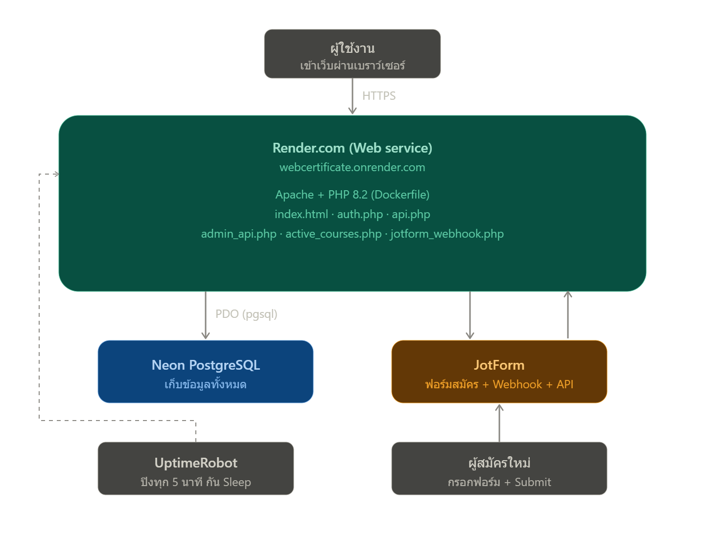

# ระบบออกใบประกาศนียบัตร — ศูนย์อบรมคอมพิวเตอร์ วัดพระธรรมกาย

ระบบออกใบประกาศนียบัตรให้ผู้เข้าอบรม พร้อมระบบจัดการหลักสูตร/รายชื่อผู้เรียน รับสมัครผ่านฟอร์มออนไลน์ของบริษัทแบบอัตโนมัติ (บันทึกเข้าทั้ง Airtable เดิมและระบบใหม่พร้อมกัน) และ **ส่งคำขออนุมัติจากหัวหน้ากอง (CAS) ให้ผู้สมัครอัตโนมัติหลังกรอกฟอร์ม** พร้อมแท็บให้แอดมินดูสถานะคำขอทั้งหมด

**เว็บไซต์ใช้งานจริง:** https://comtrain-webcertificate.onrender.com/

---

## สารบัญ
1. [ภาพรวมระบบทำอะไรได้บ้าง](#ภาพรวมระบบทำอะไรได้บ้าง)
2. [สถาปัตยกรรมระบบ (System Architecture)](#สถาปัตยกรรมระบบ-system-architecture)
3. [เทคโนโลยีที่ใช้](#เทคโนโลยีที่ใช้)
4. [โครงสร้างไฟล์ + คำอธิบายทีละไฟล์](#โครงสร้างไฟล์--คำอธิบายทีละไฟล์)
5. [โครงสร้างฐานข้อมูล](#โครงสร้างฐานข้อมูล)
6. [Data Flow แต่ละสถานการณ์](#data-flow-แต่ละสถานการณ์)
7. [การเชื่อมต่อ JotForm ของบริษัท (Dual-write เข้า Airtable + เว็บใหม่)](#การเชื่อมต่อ-jotform-ของบริษัท-dual-write-เข้า-airtable--เว็บใหม่)
8. [ระบบขออนุมัติ (CAS) — ล็อกอิน DKC + หน้า Thank you + แท็บแอดมิน](#ระบบขออนุมัติ-cas--ล็อกอิน-dkc--หน้า-thank-you--แท็บแอดมิน)
9. [วิธีรันโปรเจกต์บนเครื่องตัวเอง (Local Setup)](#วิธีรันโปรเจกต์บนเครื่องตัวเอง-local-setup)
10. [Environment Variables ที่ต้องตั้งค่า](#environment-variables-ที่ต้องตั้งค่า)
11. [ข้อจำกัดและวิธีแก้ที่ใช้อยู่](#ข้อจำกัดและวิธีแก้ที่ใช้อยู่)
12. [ปัญหาที่เคยเจอ และวิธีแก้ (Troubleshooting Log)](#ปัญหาที่เคยเจอ-และวิธีแก้-troubleshooting-log)
13. [ประวัติการพัฒนา](#ประวัติการพัฒนา)
14. [สถานะปัจจุบันและงานที่เหลือ](#สถานะปัจจุบันและงานที่เหลือ)

---

## ภาพรวมระบบทำอะไรได้บ้าง

ระบบนี้มี 3 กลุ่มผู้ใช้งาน (และมีระบบขออนุมัติทำงานต่อเนื่องจากกลุ่มที่ 3 — ดูหัวข้อ [ระบบขออนุมัติ](#ระบบขออนุมัติ-cas--ล็อกอิน-dkc--หน้า-thank-you--แท็บแอดมิน)):

### 1. ผู้เข้าอบรม (หน้าแรกของเว็บ — Public)
เลือก **ปีที่อบรม → หลักสูตร → ชื่อตัวเอง** แล้วกดดาวน์โหลดใบประกาศนียบัตรเป็นไฟล์ภาพ (PNG) ได้ทันที ระบบจะดึงชื่อ-นามสกุลมาใส่ในใบประกาศให้อัตโนมัติ พร้อม QR Code สำหรับตรวจสอบความถูกต้อง (ถ้าหลักสูตรนั้นตั้งค่า verify URL ไว้)

### 2. เจ้าหน้าที่ (Admin Panel — ต้อง Login)
- **จัดการหลักสูตร** — เพิ่ม/แก้ไข/ลบหลักสูตร, วันที่อบรม, ปี พ.ศ., ลิงก์ QR verify (มีทั้งชื่อสั้น `short_name` และชื่อยาว `long_key`)
- **จัดการรายชื่อผู้เรียน** — ดู/ค้นหา/แก้ไข/ลบ พร้อมแบ่งหน้าและเรียงลำดับ
- **เปิด/ปิดรับสมัคร** — เลือกหลักสูตรที่เปิดให้สมัคร แล้วกด "Sync to JotForm" เพื่ออัปเดต dropdown ของฟอร์มให้ตรงกับหลักสูตรที่เปิดอยู่จริง (แสดงและ sync เป็น**ชื่อยาว** `long_key` ไม่ใช่ชื่อย่ออีกต่อไป — ดูหัวข้อ [Data Flow ข้อ 3](#3-admin-เปิดปิดคอร์สแล้ว-sync-ไปยัง-jotform))
- **คำขออนุมัติ** — แท็บที่ 3 บนแถบบน แสดงคำขออนุมัติของทุกคนพร้อมสถานะ (รออนุมัติ / อนุมัติแล้ว / ไม่อนุมัติ) ค้นหาและกรองสถานะได้ ติดตามสถานะอย่างเดียว ไม่กระทบการออกใบประกาศ
- **นำเข้าข้อมูลจาก Airtable** — ดึงรายชื่อคอร์สและผู้สมัครจาก Airtable (ทั้งชุดข้อมูลเก่า และรายการที่ตกหล่นจาก webhook เพราะยังไม่มีคอร์สในระบบ) เปรียบเทียบกับคอร์สในระบบ แบ่งเป็น "คอร์สใหม่" และ "คอร์สที่มีอยู่แล้ว" แล้วเลือกนำเข้าเป็นรายคอร์ส

### 3. ผู้สมัครเรียนใหม่ (ภายนอกบริษัท ผ่าน JotForm ของบริษัท)
กรอกฟอร์มสมัครที่ **https://form.jotform.com/231301336713444** (ฟอร์มจริงของบริษัท ไม่ใช่ฟอร์มทดลองอีกต่อไป) เลือกหลักสูตรจาก dropdown แล้วกด Submit — ข้อมูลจะถูกส่งเข้า **2 ที่พร้อมกันโดยอัตโนมัติ**:
1. **Airtable ของบริษัท** (การเชื่อมต่อเดิม ไม่ถูกแตะต้อง ทำงานเหมือนเดิมทุกประการ)
2. **Neon (ระบบเว็บใหม่นี้)** ผ่าน Webhook ที่เพิ่มเข้ามาเสริม

จากนั้น JotForm พาผู้สมัครไปที่หน้า **Thank you ของเว็บนี้** (`thankyou.html`) ซึ่งตัดสินในโค้ดว่า แสดงหน้า "ขอบคุณ" พร้อมชื่อ หลักสูตร และ QR Code กลุ่มไลน์ (ไฟล์ `assets/images/line-qr.png` ถ้ายังไม่มีไฟล์จะแสดงกรอบสีเทา) ถ้าประเภทสมาชิกเป็นประเภทอื่นที่ไม่ใช่ "ผู้นำบุญ สาธุชนทั่วไป อื่น ๆ" (มีบัญชี AD และกอง) จะถามว่า "ต้องการส่งคำขออนุมัติถึงหัวหน้ากองเลยไหม" ปุ่ม **ตกลง** = ล็อกอิน DKC แล้วส่งคำขอ (กลับมาหน้าเดิมพร้อมชื่อ/อีเมล/ตำแหน่ง/สังกัดหัวหน้ากอง) ปุ่ม **ยกเลิก** = ไม่ส่ง และมีปุ่ม "ส่งคำขอภายหลัง" (ผู้สมัครเลือกไม่ส่งได้)

> ⚠️ **สำคัญ:** แอดมินยังคงไปเปิด/ปิดคอร์สและแก้ไข dropdown ที่หน้า **JotForm โดยตรง** เหมือนระบบเดิม ไม่ได้ทำผ่านเว็บนี้อีกต่อไป (ฟีเจอร์ "เปิดรับสมัคร" ในเว็บยังมีโค้ดอยู่ แต่ไม่ได้ใช้งานจริงกับฟอร์มบริษัท) — ดูรายละเอียดที่หัวข้อ [การเชื่อมต่อ JotForm ของบริษัท](#การเชื่อมต่อ-jotform-ของบริษัท-dual-write-เข้า-airtable--เว็บใหม่)

---

## สถาปัตยกรรมระบบ (System Architecture)



### ระบบขออนุมัติ: เว็บใบประกาศทำเองทั้งหมด (ไม่พึ่ง DKC Portal)

```
[JotForm] ──redirect──▶ thankyou.html ──(ประเภทต้องขออนุมัติ)──▶ backend/approval_start.php
                              ▲                                        │ (ยังไม่ล็อกอิน)
                              │                                        ▼
                              │                  backend/oauth_login.php ──▶ DKC OAuth (oauth.dhammakaya.network)
                              │                                                      │
                              │                  backend/oauth_callback.php ◀────────┘ (redirect_uri)
                              │                                        │
                              │                  backend/approval_submit.php ──▶ CAS /api/cas/request
                              │                                        │ บันทึก Neon (approval_requests)
                              └──── redirect กลับ ?ref=JF-... ◀────────┘
CAS ──(หัวหน้ากองกดอนุมัติ/ปฏิเสธ)──▶ backend/cas_callback.php ──▶ ถาม CAS reqstat ซ้ำ ──▶ อัปเดต Neon
thankyou.html ──▶ approval_result.php ──▶ Neon        แท็บ "คำขออนุมัติ" ──▶ admin_api.php ──▶ Neon
```

- เว็บใบประกาศ (Render, PHP) ล็อกอินผู้ใช้ผ่าน DKC OAuth เอง ส่งคำขอไป CAS เอง และเก็บคำขอ/สถานะใน **Neon** ตาราง `approval_requests`
- DKC Portal (Cloudflare Worker) **เลิกใช้แล้ว** (ข้อมูลเก่าใน D1 ไม่ถูกย้าย)

### สถาปัตยกรรมภายในฝั่ง Backend

โค้ดฝั่ง PHP แบ่งเป็น 3 ชั้นตามหลัก separation of concerns:

```
ไฟล์ endpoint (admin_api.php, api.php, active_courses.php, jotform_webhook.php)
        │  รับ HTTP request, validate input เบื้องต้น, ตอบ JSON กลับ
        ▼
Repository layer (backend/lib/CourseRepository.php, StudentRepository.php)
        │  รวม SQL ทั้งหมดไว้ที่เดียว ไม่ปนกับ HTTP handling
        ▼
Database (Neon PostgreSQL)
```

พร้อมด้วยไฟล์ shared ที่ endpoint ทุกตัวเรียกใช้ร่วมกัน:
- **`backend/lib/load_env.php`** — โหลดไฟล์ `.env` เข้า environment อัตโนมัติตอนรันบนเครื่อง local (บน Render ข้ามไปเลย เพราะไม่มีไฟล์ `.env`)
- **`backend/lib/require_admin.php`** — middleware เช็คสิทธิ์ admin กลาง ใช้ที่เดียวไม่ต้องเขียนซ้ำทุกไฟล์
- **`backend/lib/error_handler.php`** — จัดการ error กลาง log รายละเอียดจริงไว้ฝั่ง server เท่านั้น ส่งข้อความทั่วไปกลับไปหา client (ไม่เผยรายละเอียด database ให้ผู้ไม่หวังดี)

### สถาปัตยกรรมภายในฝั่ง Frontend

`index.html` เหลือแค่ markup ล้วน ๆ ไม่มี CSS/JavaScript ฝังอยู่ในไฟล์แล้ว โดยแยกออกเป็น:

```
index.html (markup เท่านั้น)
   ├── assets/css/style.css        สไตล์ทั้งหมดของเว็บ
   └── assets/js/
         ├── certificate.js        หน้าดาวน์โหลดใบประกาศ (โหลดข้อมูล, dropdown, พรีวิว, ดาวน์โหลด PNG)
         ├── auth.js               ระบบ login/logout admin
         └── admin.js              ตรรกะหน้า Admin Panel ทั้งหมด (ตารางคอร์ส, ตารางผู้เรียน, เปิดรับสมัคร, นำเข้า Airtable)
```

---

## เทคโนโลยีที่ใช้

| ส่วน | เทคโนโลยี | หน้าที่ |
|---|---|---|
| **Frontend** | HTML + CSS + Vanilla JavaScript (แยกไฟล์ตาม responsibility) | หน้าดาวน์โหลดใบประกาศ + หน้า Admin Panel |
| **สร้างภาพใบประกาศ** | [html2canvas](https://html2canvas.hertzen.com/) | แปลง HTML เป็นไฟล์ภาพ PNG ให้ดาวน์โหลด |
| **QR Code** | [qrcodejs](https://github.com/davidshimjs/qrcodejs) | สร้าง QR Code บนใบประกาศ |
| **Backend** | PHP 8.2 (ไม่ใช้ framework, ใช้ PDO ตรง ๆ) | ประมวลผล API ทั้งหมด แบ่งเป็น Controller + Repository layer |
| **Database** | [Neon](https://neon.tech) — PostgreSQL แบบ Serverless | เก็บข้อมูลหลักสูตรและผู้เรียนทั้งหมด |
| **Hosting** | [Render](https://render.com) — Web Service แบบ Docker (แผนฟรี) | รันเว็บ PHP ให้มี public URL |
| **Container** | Docker (`php:8.2-apache` + extension `pdo_pgsql`) | กำหนด environment ให้ Render รันได้ตรงตามที่ต้องการ |
| **รับสมัครออนไลน์** | [JotForm](https://www.jotform.com) — **ฟอร์มบริษัทจริง `231301336713444`** | ฟอร์มให้คนภายนอกกรอกสมัครเรียน ส่งข้อมูลเข้า Airtable บริษัท (เดิม) + Webhook ของเว็บนี้ (ใหม่) พร้อมกัน |
| **นำเข้าข้อมูลเก่า/ตกหล่น** | [Airtable REST API](https://airtable.com/developers/web/api/introduction) | ดึงรายชื่อผู้สมัครและคอร์สจาก Airtable บริษัท นำเข้าสู่ Neon (ทั้งข้อมูลเก่าครั้งเดียว และรายการที่ webhook หาไม่คอร์สเจอ) |
| **ระบบขออนุมัติ** | PHP บน Render + Neon + DKC OAuth/CAS (`oauth.dhammakaya.network`) | ล็อกอินผู้ใช้ ส่งคำขออนุมัติถึงหัวหน้ากอง เก็บประวัติ/สถานะคำขอใน Neon (แทน DKC Portal เดิม) |
| **Keep-alive** | [UptimeRobot](https://uptimerobot.com) | ปิงเว็บทุก 5 นาที ป้องกัน Render sleep หลัง idle 15 นาที |

---

## โครงสร้างไฟล์ + คำอธิบายทีละไฟล์

```
webcertificate/
│   .env                    ← สร้างเองบนเครื่อง local (ห้าม commit ขึ้น GitHub)
│   .gitignore
│   Dockerfile
│   index.html
│   thankyou.html           ← หน้า Thank you หลังกรอกฟอร์ม (ตัดสินประเภท + แสดงผลคำขออนุมัติ)
│   README.md
│
├───assets
│   ├───css
│   │       style.css
│   │
│   ├───docs
│   │       architecture-diagram.png
│   │
│   ├───images
│   │       line-qr.png
│   │       logo.png
│   │       main1.png
│   │
│   └───js
│           admin.js
│           auth.js
│           certificate.js
│
├───backend
│   │   active_courses.php
│   │   admin_api.php
│   │   api.php
│   │   auth.php
│   │   approval_result.php     ← endpoint สาธารณะให้ thankyou.html ถามผลคำขอ (ตามรหัสอ้างอิง)
│   │   jotform_webhook.php     ← รับ webhook จากฟอร์มบริษัท 231301336713444
│   │
│   └───lib
│           AirtableClient.php
│           CourseRepository.php
│           error_handler.php
│           load_env.php
│           │           require_admin.php
│           StudentRepository.php
│
└───database
        config.php
        schema.sql
        seed.sql
```

### `Dockerfile`
ตั้งค่า container ที่ Render ใช้รันเว็บ: ใช้ image ตั้งต้น `php:8.2-apache`, ติดตั้ง `pdo_pgsql` extension (จำเป็นสำหรับต่อ Neon), คัดลอกโค้ดเข้า `/var/www/html/`, ตั้งให้ Apache ฟัง port ที่ Render กำหนดผ่าน environment variable `PORT`

### `.env` (ไม่ได้อยู่ใน Git)
ไฟล์เก็บ environment variables สำหรับรันบนเครื่อง local เท่านั้น ถูก ignore ไว้ใน `.gitignore` แล้ว ห้าม commit ขึ้น GitHub เด็ดขาด บน Render ตั้งค่าผ่าน Dashboard → Environment แทน

### `index.html`
Markup ล้วน ๆ ของหน้าเว็บทั้งหมด แบ่งเป็น 2 ส่วนหลักที่สลับกันด้วยแท็บ: หน้าดาวน์โหลดใบประกาศ (public) และหน้า Admin Panel (ต้อง login) ไม่มี CSS/JavaScript ฝังอยู่ในไฟล์นี้เลย

### `thankyou.html`
หน้า Thank you ของผู้สมัคร (ไฟล์เดียว มี CSS/JS ในตัว ไม่ผูกกับ `index.html`) JotForm พามาที่หน้านี้พร้อม `?name=&course=&type=` ทำงาน 3 แบบ:

| สถานการณ์ | พฤติกรรม |
|---|---|
| มี `type` ที่ไม่ขึ้นต้นด้วย "ผู้นำบุญ" (พร้อมชื่อและคอร์ส) | แสดงกล่องถาม ตกลง/ยกเลิก ถ้ากด "ตกลง" ไป `backend/approval_start.php?name=&course=&type=` (ไม่ส่งอัตโนมัติ) |
| ประเภท "ผู้นำบุญ..." หรือไม่มี `type` | แสดง "ขอบคุณ คุณ[ชื่อ]" + หลักสูตร (ใส่ด้วย `textContent` ป้องกัน XSS และจำกัดความยาว) |
| มี `?ref=JF-...` (ส่งกลับมาหลังส่งคำขอ) | เรียก `backend/approval_result.php` แล้วแสดง "ส่งคำขออนุมัติถึงหัวหน้ากองแล้ว" + ชื่อหัวหน้ากอง (หรือสถานะอนุมัติ/ไม่อนุมัติ) |
| มี `?e=<code>` (ส่งไม่สำเร็จ) | แสดงข้อความตามรหัส `missing`/`cas`/`upstream`/`dup`/`login`/`db` + ปุ่ม "ลองส่งใหม่" (ชี้ `backend/approval_submit.php` ตายตัว ไม่รับลิงก์จาก URL) |


### `assets/css/style.css`
สไตล์ทั้งหมดของเว็บ (สี, layout, responsive, animation) แยกออกจาก `index.html` เพื่อให้แก้ไขและอ่านง่ายขึ้น

### `assets/js/certificate.js`
ตรรกะหน้าดาวน์โหลดใบประกาศ: โหลดรายชื่อจาก `api.php`, สร้าง dropdown เลือกปี/หลักสูตร/ชื่อ, อัปเดตพรีวิวใบประกาศแบบ real-time, สร้าง QR Code, และแปลงใบประกาศเป็นไฟล์ PNG ผ่าน html2canvas

### `assets/js/auth.js`
ระบบ login/logout admin ฝั่ง frontend: เปิด/ปิด modal login, เรียก `backend/auth.php`, เก็บสถานะ session ไว้ใน `sessionStorage`, และแสดง/ซ่อนแท็บ admin ตามสถานะ

### `assets/js/admin.js`
ตรรกะหน้า Admin Panel ทั้งหมด: สลับแท็บ (ดาวน์โหลด / จัดการข้อมูล / **คำขออนุมัติ** — `loadApprovalsPage()`, `fetchApprovals()` มีสรุปจำนวนกรองสถานะได้ ค้นหาแบบ debounce แบ่งหน้าละ 20 และแปลงเวลา UTC เป็นเวลาไทย), ตารางคอร์ส (ค้นหา/กรอง/เรียงลำดับ), ตารางรายชื่อผู้เรียน (ค้นหา/กรอง/เรียงลำดับ/แบ่งหน้า), modal เพิ่ม/แก้ไขข้อมูล, หน้าเปิดรับสมัคร (**แสดงชื่อคอร์สแบบยาว `long_key` เป็นหลัก + ชื่อย่อ `short_name` กำกับไว้ด้านล่างตัวเล็ก**) + ปุ่ม Sync to JotForm และหน้านำเข้าข้อมูลจาก Airtable (แสดงผลแบบกลุ่มคอร์ส)

### `backend/lib/load_env.php`
โหลดไฟล์ `.env` เข้า environment อัตโนมัติตอนรันบนเครื่อง local — ทุก endpoint `require_once` ไฟล์นี้ไว้บนสุด บน Render ไม่มีไฟล์ `.env` ก็ข้ามไปเลยโดยไม่มีผลอะไร ออกแบบมาให้ใช้งานได้ทั้งสองสภาพแวดล้อมโดยไม่ต้องแก้โค้ด

### `backend/lib/require_admin.php`
Middleware กลาง — เริ่ม session, ตั้ง response header เป็น JSON, เช็คว่า login เป็น admin อยู่ไหม ถ้าไม่ใช่ตอบ 403 ทันที ทุกไฟล์ endpoint ที่ต้องการสิทธิ์ admin (`admin_api.php`, `active_courses.php`) เรียกใช้ไฟล์นี้แค่บรรทัดเดียวแทนเขียนโค้ดเช็คซ้ำ

### `backend/lib/error_handler.php`
ฟังก์ชันกลาง `send_error_response()` — log รายละเอียด exception จริงไว้ฝั่ง server ผ่าน `error_log()` (ดูได้ที่ Render → Logs) แต่ส่งข้อความทั่วไปกลับไปหา client เท่านั้น ป้องกันไม่ให้รายละเอียดโครงสร้าง database รั่วไหลออกไป

### `backend/lib/AirtableClient.php`
ตัวเชื่อมต่อ Airtable REST API — ดึง records ทั้งหมดจาก table ที่กำหนด วน pagination อัตโนมัติ (Airtable จำกัด 100 แถวต่อ request) อ่าน credential จาก environment variables

### `backend/lib/CourseRepository.php`
รวม SQL ทั้งหมดที่เกี่ยวกับตาราง `courses` และ `active_courses` ไว้ที่เดียว — endpoint files เรียกใช้ผ่าน class นี้แทนเขียน SQL เอง เมธอดหลัก:

| เมธอด | หน้าที่ |
|---|---|
| `listWithStudentCount()` | ดึงคอร์สทั้งหมดพร้อมนับจำนวนผู้เรียน (หน้า "คอร์สทั้งหมด") |
| `listWithActiveFlag()` | ดึงคอร์สทั้งหมดพร้อม flag เปิด/ปิดรับสมัคร **คืนค่าทั้ง `short_name` และ `long_key`** (หน้า "เปิดรับสมัคร") |
| `listActiveLongKeys()` | ดึง**ชื่อยาว**ของคอร์สที่เปิดรับสมัครอยู่ทั้งหมด ใช้ตอน sync ไป JotForm *(เดิมชื่อ `listActiveShortNames()` — เปลี่ยนให้ sync เป็นชื่อยาวแทนชื่อย่อ)* |
| `findByShortName()` | ค้นหาคอร์สจากชื่อย่อแบบตรงเป๊ะ |
| `findByShortNameOrLongKey()` | ค้นหาคอร์สจากชื่อ โดยเทียบได้ทั้ง `short_name` และ `long_key` — ใช้ในหน้านำเข้า Airtable และใน `jotform_webhook.php` (กันเคส dropdown ใน JotForm เปลี่ยนไปมาระหว่างชื่อสั้น/ยาว) |
| `add()` / `update()` / `delete()` | จัดการหลักสูตร |
| `activate()` / `deactivate()` | เปิด/ปิดรับสมัครคอร์ส |

### `backend/lib/StudentRepository.php`
รวม SQL ทั้งหมดที่เกี่ยวกับตาราง `students` ไว้ที่เดียว (แบ่งหน้า+ค้นหา+กรอง+เรียงลำดับ, add, update, delete, insert จาก webhook, insert จาก Airtable, ดึงรายชื่อทั้งหมดสำหรับหน้า public)

> หมายเหตุ: `jotform_webhook.php` เปลี่ยนมาเรียก `insertFromAirtable()` แทน `insertFromWebhook()` แล้ว เพราะฟอร์มบริษัทมีฟิลด์ละเอียดกว่าฟอร์มทดลองเดิม (มีคณะ/สาขา/สถาบัน/วันเกิด/ระดับการศึกษาด้วย) — ดูรายละเอียดที่หัวข้อ [การเชื่อมต่อ JotForm ของบริษัท](#การเชื่อมต่อ-jotform-ของบริษัท-dual-write-เข้า-airtable--เว็บใหม่)

### `backend/auth.php`
ระบบ login ของ admin ใช้ PHP session (`$_SESSION['is_admin']`) อ่าน username/password จาก environment variables (`ADMIN_USER`, `ADMIN_PASS`) — `action=login`, `action=logout`, `action=check`

### `backend/api.php`
Endpoint สาธารณะ (ไม่ต้อง login) ที่หน้าดาวน์โหลดใบประกาศเรียกใช้ตอนโหลดหน้าเว็บ — ดึงรายชื่อผู้เรียนทั้งหมดผ่าน `StudentRepository::listAllWithCourse()` จัดรูปแบบ JSON คล้าย Airtable เดิม

### `backend/admin_api.php`
Endpoint หลักสำหรับ CRUD ทั้งหมดในหน้า Admin (ต้อง login ผ่าน `require_admin.php`) เป็น thin controller ที่เรียกใช้ `CourseRepository` และ `StudentRepository`:

| Action | หน้าที่ |
|---|---|
| `list_courses` | ดึงคอร์สทั้งหมด พร้อมนับจำนวนผู้เรียนต่อคอร์ส |
| `add_course` / `update_course` / `delete_course` | จัดการหลักสูตร |
| `list_students` | ดึงรายชื่อผู้เรียนแบบแบ่งหน้า รองรับค้นหา/กรองปี/กรองคอร์ส/เรียงลำดับ (whitelist คอลัมน์ป้องกัน SQL Injection ผ่าน `ORDER BY`) |
| `get_student` | ดึงข้อมูลผู้เรียน 1 คนแบบละเอียด |
| `add_student` / `update_student` / `delete_student` | จัดการรายชื่อผู้เรียน |
| `airtable_preview` | ดึงข้อมูลจาก Airtable มา group ตามคอร์ส เปรียบเทียบกับคอร์สในระบบ แยกเป็น "คอร์สใหม่" / "คอร์สที่มีอยู่แล้ว" (query database แค่ครั้งเดียว ไม่ว่าจะมีกี่ record) — ใช้เมนูนี้ดึงทั้งข้อมูลเก่าทั้งหมด และผู้สมัครที่ webhook เคยหาคอร์สไม่เจอมาก่อน |
| `list_approval_requests` | ดึงรายการคำขออนุมัติจาก Neon (`ApprovalRepository::listPage`) รองรับ `page`, `per_page`, `status`, `q` |
| `airtable_import_course` | สร้างคอร์สใหม่ (ถ้าจำเป็น) + นำเข้านักเรียนที่เลือกในคอร์สนั้น ในทีเดียวภายใน transaction เดียวกัน |

### `backend/approval_result.php`
Endpoint **สาธารณะ** (ไม่ต้อง login) สำหรับ `thankyou.html` รับ `?ref=` ที่ต้องตรงรูปแบบ `JF-<เลข 10–14 หลัก>-<hex 8 ตัว>` อ่านจาก Neon แล้วตอบเฉพาะ `found`, `status` (`pending`/`approved`/`rejected`), `approver_name` — **ไม่คืนข้อมูลผู้สมัครเลย** รหัสอ้างอิงสุ่มเดาไม่ได้จึงปลอดภัยพอสำหรับการแสดงผลแบบนี้

### `backend/active_courses.php`
Endpoint สำหรับหน้า "เปิดรับสมัคร" (ต้อง login) อ่าน JotForm API Key/Form ID/Field ID จาก environment variables — **ปัจจุบันไม่ได้ใช้งานคู่กับฟอร์มบริษัทจริง** (แอดมินเปิด/ปิดคอร์สที่หน้า JotForm โดยตรงแทน) แต่โค้ดยังคงเก็บไว้เผื่อกลับมาใช้ในอนาคต:

| Action | หน้าที่ |
|---|---|
| `list` | ดึงคอร์สทั้งหมด พร้อม flag `is_active` |
| `toggle` | เปิด/ปิดคอร์ส |
| `sync_jotform` | ดึง**ชื่อยาว** (`long_key`) ของคอร์สที่เปิดอยู่จาก Neon ผ่าน `CourseRepository::listActiveLongKeys()` → เรียก JotForm API โดยตรงเพื่ออัปเดตตัวเลือกใน dropdown |

### `backend/jotform_webhook.php`
**Endpoint สำคัญที่สุดในระบบ** — จุดเดียวที่ต้องเปิดรับ request จากภายนอกอินเทอร์เน็ตจริง ๆ (ไม่ต้อง login เพราะ JotForm server เป็นคนเรียก)

**รับข้อมูลจากฟอร์มบริษัท `231301336713444`** (ฟอร์มทดลอง `261701468554460` ปัจจุบันใช้ทดสอบระบบขออนุมัติเท่านั้น ไม่ใช่ช่องทางรับสมัครจริง) ทำงานดังนี้:

```
รับข้อมูลดิบจาก JotForm ผ่าน field 'rawRequest'
        → แกะฟิลด์ตาม field ID ของฟอร์มบริษัท (ดูตาราง mapping ในหัวข้อถัดไป)
        → CourseRepository::findByShortNameOrLongKey() หา course_id
              ├─ เจอ    → StudentRepository::insertFromAirtable() บันทึกเข้า Neon
              └─ ไม่เจอ → ไม่บันทึก, ตอบ error พร้อมข้อความแนะนำให้ไปที่เมนู
                          "นำเข้าข้อมูลจาก Airtable" เพื่อเพิ่มคอร์สนี้ก่อน
        → log ผลลัพธ์ผ่าน error_log() ทุกครั้ง (ทั้งสำเร็จและ error)
```

> รายละเอียด field mapping ทั้งหมด และการตั้งค่า Webhook integration ฝั่ง JotForm ดูที่หัวขัด [การเชื่อมต่อ JotForm ของบริษัท](#การเชื่อมต่อ-jotform-ของบริษัท-dual-write-เข้า-airtable--เว็บใหม่)

### `database/schema.sql`
คำสั่งสร้างตารางทั้งหมด เขียนด้วย **PostgreSQL syntax จริง** (`SERIAL`, `REFERENCES ... ON DELETE CASCADE` ฯลฯ) ตรงกับโครงสร้างที่ใช้งานจริงบน Neon

### `database/seed.sql`
ข้อมูลตัวอย่างสำหรับ demo/ทดสอบระบบ — **ทุกชื่อ/เบอร์/อีเมลเป็นข้อมูลสมมติทั้งหมด** ใช้รันหลัง `schema.sql` เพื่อทดลองใช้งานระบบโดยไม่ต้องพึ่งข้อมูลจริงของบริษัท

### `database/config.php`
อ่านค่าการเชื่อมต่อ Neon จาก **Environment Variables** (`DB_HOST`, `DB_PORT`, `DB_NAME`, `DB_USER`, `DB_PASS`) ไม่มี credential ฝังอยู่ในโค้ดเลย และมีฟังก์ชัน `getDB()` คืนค่า PDO connection แบบ singleton

---

## โครงสร้างฐานข้อมูล

### ตาราง `courses`
| คอลัมน์ | ความหมาย |
|---|---|
| `id` | primary key (SERIAL) |
| `long_key` | ชื่อยาว ต้องไม่ซ้ำกัน (UNIQUE) — ใช้ match กับ field "โปรแกรมที่สมัคร" ใน Airtable **และปัจจุบันเป็นค่าที่แสดง/sync ไปที่ dropdown ของ JotForm ด้วย** |
| `short_name` | ชื่อย่อ — เดิมใช้ match กับ dropdown ใน JotForm ปัจจุบันใช้เป็นข้อมูลอ้างอิงเสริมในหน้า admin เท่านั้น |
| `training_date` | วันที่อบรม (ข้อความอิสระ) |
| `year_be` | ปี พ.ศ. 4 หลัก ใช้กรองข้อมูล |
| `verify_url` | ลิงก์ปลายทางของ QR Code บนใบประกาศ |

> **หมายเหตุเรื่อง `long_key`:** เป็นข้อความอิสระที่แอดมินกรอกเอง ไม่มีรูปแบบบังคับ บางคอร์สอาจมีชื่อย่อกำกับในวงเล็บ บางคอร์สไม่มี ขึ้นอยู่กับตอนกรอกข้อมูล ไม่กระทบการทำงานของระบบ

### ตาราง `students`
เก็บข้อมูลผู้เรียนแต่ละคน ผูกกับหลักสูตรผ่าน `course_id` (Foreign Key, `NOT NULL`, `ON DELETE CASCADE`) มีฟิลด์ข้อมูลส่วนตัวครบถ้วน (ชื่อ, เบอร์, อีเมล, หน่วยงาน, ตำแหน่ง, คณะ, สาขา, สถาบัน, วันเกิด ฯลฯ) และมี `airtable_id` สำหรับกันนำเข้าซ้ำจาก Airtable (ค่าจะเป็น `NULL` สำหรับแถวที่เข้ามาผ่าน webhook โดยตรง)

### ตาราง `active_courses`
ตารางเชื่อม (junction table) เก็บแค่ `course_id` ที่กำลังเปิดรับสมัครอยู่ — ถ้ามีแถวในนี้แปลว่าคอร์สนั้นเปิดรับสมัคร ถ้าไม่มีแปลว่าปิด (ปัจจุบันไม่ได้ผูกกับการเปิด/ปิดจริงบน JotForm ของบริษัทแล้ว เพราะแอดมินไปจัดการที่ JotForm โดยตรง)

---

## Data Flow แต่ละสถานการณ์

### 1. ผู้เข้าอบรมดาวน์โหลดใบประกาศ
```
เปิดเว็บ → certificate.js เรียก api.php → StudentRepository::listAllWithCourse()
        → เลือกปี/คอร์ส/ชื่อ (กรองฝั่ง frontend) → พรีวิวใบประกาศ real-time
        → กด "ดาวน์โหลด" → html2canvas แปลงเป็น PNG
```

### 2. ผู้สมัครใหม่กรอกฟอร์ม JotForm บริษัท (Dual-write)
```
[ผู้สมัคร] กรอกฟอร์ม 231301336713444 + เลือกหลักสูตร → กด Submit
        │
        ├──→ (integration เดิม) Airtable บริษัท — บันทึกตามปกติ ไม่เปลี่ยนแปลง
        │
        └──→ (integration ใหม่) Webhook → jotform_webhook.php
                   → decode rawRequest, แกะฟิลด์ตาม field id ของฟอร์มบริษัท
                   → CourseRepository::findByShortNameOrLongKey() หา course_id
                        ├─ เจอ    → StudentRepository::insertFromAirtable() → ตอบ {ok:true, id:...}
                        └─ ไม่เจอ → ไม่บันทึก → ตอบ {ok:false, error:"..."} (Airtable ยังบันทึกได้ปกติ)
```
รายละเอียดเต็มดูที่หัวข้อ [การเชื่อมต่อ JotForm ของบริษัท](#การเชื่อมต่อ-jotform-ของบริษัท-dual-write-เข้า-airtable--เว็บใหม่)

### 3. Admin เปิด/ปิดคอร์สแล้ว Sync ไปยัง JotForm *(ฟีเจอร์นี้ไม่ได้ใช้กับฟอร์มบริษัทแล้ว — เก็บโค้ดไว้เผื่ออนาคต)*
```
[Admin] ติ๊กเปิด/ปิดคอร์ส → admin.js เรียก active_courses.php?action=toggle
        → CourseRepository::activate()/deactivate()
[Admin] กด "Sync to JotForm" → active_courses.php?action=sync_jotform
        → CourseRepository::listActiveLongKeys()   ← ดึงเป็น "ชื่อยาว" แล้ว
        → รวมชื่อคอร์สด้วย '|' → เรียก JotForm API (POST /form/{id}/question/{field})
        → JotForm อัปเดตตัวเลือกใน dropdown ของฟอร์มจริง
```
> แอดมินปัจจุบันเปิด/ปิดคอร์สโดยเข้าไปแก้ dropdown ที่หน้า JotForm ของบริษัทโดยตรงแทน ไม่ผ่านเมนูนี้

### 4. Admin นำเข้าข้อมูลจาก Airtable (ทั้งของเก่า และรายการที่ webhook หาไม่เจอคอร์ส)
```
[Admin] กด "ดึงข้อมูลจาก Airtable"
        → airtable_preview: AirtableClient::fetchAllRecords() (วน pagination จนครบ)
        → ดึง courses ทั้งหมดจาก Neon ครั้งเดียว → index เป็น map ใน PHP
        → group records ตามชื่อคอร์ส → match กับ map → แยก new_courses / existing_courses
        → แสดงตาราง 2 กลุ่ม พร้อมจำนวนคนที่รอนำเข้า

[Admin] กดปุ่ม "สร้างคอร์ส + นำเข้า" หรือ "นำเข้านักเรียน"
        → เปิด modal: ถ้าคอร์สใหม่ให้กรอกข้อมูลเพิ่ม, ติ๊กเลือกนักเรียน
        → airtable_import_course (transaction เดียว):
           1. สร้างคอร์สใหม่ถ้าจำเป็น (courseRepo::add)
           2. ดึงข้อมูลจาก Airtable ใหม่อีกครั้ง (verify ฝั่ง server)
           3. insert นักเรียนที่เลือกไว้ทีละคน (studentRepo::insertFromAirtable)
        → commit หรือ rollback ถ้าพัง
```
> **ใช้เมนูนี้เป็นทางแก้เวลา webhook หาคอร์สไม่เจอ** — เมื่อแอดมินเพิ่มคอร์สใหม่ใน JotForm dropdown ก่อนที่จะมาสร้างคอร์สในเว็บนี้ ผู้สมัครที่เลือกคอร์สนั้นจะยังเข้า Airtable ปกติ แต่ตกหล่นจาก Neon — แอดมินมาสร้างคอร์สให้ตรงชื่อ แล้วกดดึงข้อมูลจาก Airtable มานำเข้าย้อนหลังได้จากเมนูนี้

### 5. ผู้สมัครขออนุมัติจากหัวหน้ากองอัตโนมัติ
```
[ผู้สมัคร] กรอกฟอร์ม JotForm → Submit (ข้อมูลเข้า Airtable + Neon ตามข้อ 2)
        → JotForm redirect → thankyou.html?name=&course=&type=
              ├─ ประเภท "ผู้นำบุญ..." → แสดง "ขอบคุณ คุณ[ชื่อ]" (จบ)
              └─ ประเภทอื่น → (ผู้ใช้กด "ตกลง") → backend/approval_start.php?name=&course=&type=
                     → สร้างรหัส JF-<เวลา>-<hex8> เก็บใน session ฝั่ง server
                     → (ยังไม่ล็อกอิน) oauth_login.php → DKC OAuth → oauth_callback.php (ตรวจ state, แลก token, อ่าน username)
                     → approval_submit.php ส่งคำขอไป CAS (ผู้ขอ = บัญชี AD ที่ล็อกอิน, CAS หาหัวหน้ากองเอง)
                     → บันทึกลง Neon (เฉพาะเมื่อ CAS รับสำเร็จ)
                     → redirect → thankyou.html?ref=JF-...  (หรือ ?ref=...&e=<code> ถ้าไม่สำเร็จ)
        → thankyou.html เรียก approval_result.php → แสดงชื่อหัวหน้ากอง/สถานะ

[หัวหน้ากอง] กดอนุมัติ/ปฏิเสธในระบบ CAS → CAS เรียก backend/cas_callback.php
        → ถาม CAS ซ้ำ (reqstat) เพื่อยืนยันสถานะจริง → อัปเดต Neon → แท็บ "คำขออนุมัติ" เห็นสถานะใหม่

[แอดมิน] เปิดแท็บ "คำขออนุมัติ" → admin_api.php?action=list_approval_requests → Neon
```
รายละเอียดเต็มดูที่หัวข้อ [ระบบขออนุมัติ](#ระบบขออนุมัติ-cas--ล็อกอิน-dkc--หน้า-thank-you--แท็บแอดมิน)

---

## การเชื่อมต่อ JotForm ของบริษัท (Dual-write เข้า Airtable + เว็บใหม่)

### ภาพรวม

ระบบเดิมของบริษัทใช้ JotForm (`231301336713444`) ส่งข้อมูลเข้า Airtable (`appI37LT5wFrI4ITA`) อย่างเดียว ระบบใหม่ **เพิ่ม Webhook เข้าไปเสริมคู่ขนาน** โดยไม่แตะ Airtable integration เดิมเลย ทำให้พอมีคนกด Submit ฟอร์ม ข้อมูลจะเข้าทั้ง 2 ที่พร้อมกันอัตโนมัติ:

```
[คนกรอกฟอร์ม] → JotForm 231301336713444
                     ├──→ Airtable appI37LT5wFrI4ITA  (integration เดิม ไม่เปลี่ยนแปลง)
                     └──→ Webhook → jotform_webhook.php → Neon (integration ใหม่)
```

### วิธีตั้งค่า Webhook ฝั่ง JotForm

1. เข้า https://www.jotform.com/ → login ด้วยบัญชีที่เข้าถึงฟอร์มบริษัทได้
2. เปิดฟอร์ม `231301336713444` → แท็บ **Settings → Integrations**
3. ตรวจสอบว่า **Airtable** integration เดิมยังอยู่ (ไม่แตะต้อง)
4. ค้นหา **"Webhooks"** → เพิ่ม URL ปลายทาง:
   ```
   https://comtrain-webcertificate.onrender.com/backend/jotform_webhook.php
   ```
5. Save — ควรเห็น 2 integrations พร้อมกัน (Airtable + Webhooks)

### Field Mapping ของฟอร์มบริษัท (231301336713444)

| ข้อมูล | field id | JotForm key ที่ส่งมาใน `rawRequest` |
|---|---|---|
| ชื่อ | 110 | `q110_typeA110` |
| นามสกุล (ฉายา) | 111 | `q111_input111` |
| ประเภทสมาชิกองค์กร | 17 | `q17_typeA` |
| อายุ / พรรษาที่ (รวมช่องเดียว) | 60 | `q60_input60` |
| ระดับการศึกษาสูงสุด | 61 | `q61_input61` |
| คณะ | 90 | `q90_input90` |
| สาขา | 79 | `q79_input79` |
| สถาบัน/โรงเรียน | 75 | `q75_input75` |
| สังกัดหน่วยงาน/กอง/ศูนย์ | 31 | `q31_typeA31` |
| สำนัก | 32 | `q32_input59` |
| ตำแหน่ง | 33 | `q33_typeA33` |
| เบอร์ภายใน | 38 | `q38_input38['full']` ⚠️ เป็น array (`control_phone`) ต้องดึง `['full']` |
| เบอร์มือถือ | 39 | `q39_phoneNumber['full']` |
| Email | 82 | `q82_email82` |
| วันเกิด | 98 | `q98_input98` (object: year/month/day) |
| **โปรแกรมที่ต้องการสมัครเรียน (dropdown คอร์ส)** | 93 | `q93_input93` |
| วันที่ส่งแบบฟอร์ม | 9 | `q9_date` (object: year/month/day) |
| ค่าสมัครอบรม | 104 | `q104_input104` |

> ฟอร์มนี้ไม่มีช่อง "พรรษาที่" แยกจาก "อายุ" (รวมเป็นช่องเดียว) และไม่มีช่อง "สถานะหัวหน้ากอง" — ทั้งสองปล่อยเป็น `NULL` ในตาราง `students`

### การตั้งค่า Thank You Page (เชื่อมกับระบบขออนุมัติ)

ตั้งที่ฟอร์ม → **Settings → Thank You Page → Redirect to an external link after submission** ใส่ URL เดียว:

```
https://comtrain-webcertificate.onrender.com/thankyou.html?name={typeA110}%20{input111}&course={input93}&type={typeA}
```

- ตัวแปรในปีกกาคือ **Unique Name** ของฟิลด์: `typeA110` (ชื่อ), `input111` (นามสกุล), `input93` (คอร์ส), `typeA` (ประเภทสมาชิก) — ต้องตรวจให้ตรงกับฟอร์มที่ใช้ (ดูได้ที่ Properties → Advanced ของแต่ละฟิลด์)
- `%20` ระหว่างชื่อกับนามสกุลคือช่องว่าง
- **ไม่ต้องใช้ Conditions** — การแยกประเภทที่ต้องขออนุมัติทำในโค้ดของ `thankyou.html` แล้ว (ถ้าเคยตั้งเงื่อนไข "Change Thank You page" ไว้ ให้ลบออก ไม่เช่นนั้นผู้สมัครจะข้ามหน้านี้)
- สวิตช์ "Redirect with HTTP POST" ให้ปิดไว้
- ควรตั้ง/แก้ตอนไม่มีคนกรอกฟอร์มอยู่ และทดสอบ 2 กรณี: ประเภท "ผู้นำบุญ สาธุชนทั่วไป อื่น ๆ" และประเภทอื่น

> ⚠️ ถ้าโคลนฟอร์มมาทดสอบ ให้ลบ Integrations (Airtable/Webhook) ที่ติดมาด้วยก่อน มิฉะนั้นข้อมูลทดสอบจะไหลเข้าระบบจริง

### พฤติกรรมเมื่อหาคอร์สไม่เจอ

ผู้สมัครจะ**ไม่เห็น error ใด ๆ**เลยครับ (JotForm แสดงหน้า Thank you ปกติเสมอ ไม่ว่า webhook ปลายทางจะสำเร็จหรือไม่) และ **Airtable บันทึกได้ปกติเสมอ** เพราะเป็น integration อิสระจาก webhook

ฝั่งเว็บนี้จะไม่สร้างคอร์สใหม่อัตโนมัติ (ตัดสินใจไว้แล้วว่าให้ข้อมูลคอร์สสะอาดสมบูรณ์เสมอ ดีกว่า auto-create แล้วต้องมาเก็บงานทีหลัง) แต่จะ:
1. ไม่บันทึกข้อมูลผู้สมัครคนนั้นลง Neon
2. Log ข้อความ error ไว้ (ดูได้ 2 ที่ — ดูหัวข้อถัดไป)
3. ตอบกลับ JotForm ด้วยข้อความแนะนำให้แอดมินไปที่เมนู "นำเข้าข้อมูลจาก Airtable" เพื่อเพิ่มคอร์สนั้นเข้าระบบ แล้วดึงข้อมูลย้อนหลังมาได้

### วิธีเช็คว่ามีเคสหาคอร์สไม่เจอไหม

**ที่ 1 — Render Logs:** Dashboard → service → แท็บ Logs → ค้นหา `jotform_webhook`
- `[jotform_webhook] OK: ...` = บันทึกสำเร็จ
- `[jotform_webhook] ERROR: ไม่พบคอร์สชื่อ '...' ในระบบ` = ตกหล่น ต้องไปสร้างคอร์สแล้วนำเข้าย้อนหลัง

**ที่ 2 — JotForm เอง:** เปิดฟอร์ม → Settings → Integrations → Webhooks → ดู Log/History ของ integration นี้โดยเฉพาะ (กรองมาแล้วเฉพาะ webhook นี้ ไม่ปนกับ log อื่นของเว็บ)

---

## ระบบขออนุมัติ (CAS) — ล็อกอิน DKC + หน้า Thank you + แท็บแอดมิน

### หลักการ
- ผู้สมัครที่เลือกประเภทสมาชิกอื่นนอกจาก "ผู้นำบุญ สาธุชนทั่วไป อื่น ๆ" **ทุกคนมีบัญชี AD และมีกอง** จึงส่งคำขออนุมัติถึงหัวหน้ากองของตนผ่านระบบ CAS ของ DKC ได้
- ระบบ **ไม่ส่งชื่อหัวหน้ากองไปเอง** — ส่งเฉพาะบัญชีผู้ขอ แล้ว CAS หาหัวหน้ากองให้ (คืนมาที่ `ADApprover` / `HeadFullName`) ส่งถึงหัวหน้ากองคนเดียวเท่านั้น
- การอนุมัติเป็น **การติดตามสถานะเท่านั้น** ไม่มีผลต่อการสมัคร การบันทึกลง Neon หรือการออกใบประกาศ
- ข้อความถึงหัวหน้ากองสร้างอัตโนมัติ แก้โดยผู้ขอไม่ได้: หัวข้อ `ขออนุมัติสมัครอบรม: [คอร์ส]` และข้อความ `ขออนุมัติให้ [ชื่อ นามสกุล] เข้าอบรมหลักสูตร [คอร์ส]`
- `ApproveType` ตั้งไว้ที่ 1 (อนุมัติโดยหัวหน้ากอง) หากต้องเปลี่ยนเป็น 2 แก้ที่ `backend/approval_submit.php`

### Endpoint ที่เกี่ยวข้อง (ในเว็บใบประกาศ)

| ไฟล์ | หน้าที่ |
|---|---|
| `backend/approval_start.php` | รับ `?name=&course=&type=` (ตัด 100/200/100 ตัวอักษร) สร้างรหัส `JF-...` เก็บใน session แล้วไปล็อกอิน (หรือส่งคำขอทันทีถ้าล็อกอินอยู่แล้ว) |
| `backend/oauth_login.php` | สร้าง `state` สุ่ม แล้ว redirect ไป `/oauth/authorize` |
| `backend/oauth_callback.php` | **คือ redirect_uri** — ตรวจ `state`, แลก `code` เป็น token, อ่าน `username` (บัญชี AD) เก็บใน session (ไม่เก็บ token) |
| `backend/approval_submit.php` | ส่ง `POST /api/cas/request` แล้วบันทึก Neon; ส่งซ้ำด้วยรหัสเดิมไม่ได้ (ปุ่ม "ลองส่งใหม่" เรียกไฟล์นี้) |
| `backend/cas_callback.php` | **คือ CallbackURL ของ CAS** (GET, ไม่ต้องล็อกอิน) ถาม `reqstat` ซ้ำแล้วอัปเดต Neon ไม่เชื่อสถานะใน query string |
| `backend/approval_result.php` | ตอบสถานะ + ชื่อหัวหน้ากองให้ thankyou.html (อ่านจาก Neon) |
| `backend/lib/DkcOAuth.php`, `CasClient.php`, `ApprovalRepository.php`, `user_session.php` | ตัวช่วย OAuth / CAS / ตาราง Neon / session ผู้ใช้ (ชื่อคุกกี้ `DKCUSER` แยกจาก session แอดมิน) |

- `ApproveType` ตั้งไว้ที่ 1 ใน `approval_submit.php`
- รหัสอ้างอิง `JF-<epoch ms>-<hex 8 ตัว>` ใช้เป็น `ExternalRefID` ของ CAS และเป็น primary key ของ `approval_requests`
- ตาราง `approval_requests` สร้างด้วย `database/approval_requests.sql` (รันครั้งเดียวใน Neon SQL Editor) เก็บเวลาเป็น UTC
- ต้องแจ้งทีม IT ให้ลงทะเบียน redirect_uri `https://comtrain-webcertificate.onrender.com/backend/oauth_callback.php` (ต้องตรงทุกตัวอักษร) และยืนยันว่า CAS รับ CallbackURL `https://comtrain-webcertificate.onrender.com/backend/cas_callback.php`

### ฝั่งหน้าเว็บ
- **หน้า Thank you** (`thankyou.html`) — ดูหัวข้อไฟล์ด้านบน
- **แท็บ "คำขออนุมัติ"** — `admin.js (fetchApprovals)` → `backend/admin_api.php?action=list_approval_requests` → `ApprovalRepository::listPage()` (Neon) คอลัมน์: วันที่ขอ, ผู้สมัคร, คอร์ส, ประเภท, ผู้ขอ (AD), หัวหน้ากอง, สถานะ, อัปเดตล่าสุด

### รหัสผิดพลาดบนหน้า Thank you (`e`)
| รหัส | ความหมาย |
|---|---|
| `missing` | ชื่อ/คอร์ส/ประเภทไม่ครบ |
| `cas` | CAS ไม่รับคำขอ (เช่น หาหัวหน้ากองไม่พบ) — รายละเอียดดูใน Cloudflare Logs |
| `upstream` | CAS ไม่ตอบ/ตอบผิดรูปแบบ |
| `dup` | `ref` นี้ถูกใช้โดยผู้ใช้คนอื่นแล้ว |

---

## วิธีรันโปรเจกต์บนเครื่องตัวเอง (Local Setup)

1. **เตรียม PostgreSQL database** — ใช้ [Neon](https://neon.tech) (ฟรี) หรือ Postgres ที่ติดตั้งเองก็ได้

2. **สร้างตารางและข้อมูลตัวอย่าง**
   ```bash
   psql "postgresql://<user>:<pass>@<host>/<dbname>" -f database/schema.sql
   psql "postgresql://<user>:<pass>@<host>/<dbname>" -f database/seed.sql
   ```

3. **สร้างไฟล์ `.env`** ที่ root ของโปรเจกต์ (ดูรายการตัวแปรทั้งหมดที่หัวข้อถัดไป):
   ```env
   ADMIN_USER=admin
   ADMIN_PASS=your_password

   DB_HOST=your-neon-host
   DB_PORT=5432
   DB_NAME=neondb
   DB_USER=neondb_owner
   DB_PASS=your_db_password

   APP_URL=https://comtrain-webcertificate.onrender.com
   OAUTH_BASE_URI=https://oauth.dhammakaya.network
   OAUTH_CLIENT_ID=your_client_id
   OAUTH_CLIENT_SECRET=your_client_secret
   OAUTH_REDIRECT_URI=https://comtrain-webcertificate.onrender.com/backend/oauth_callback.php

   AIRTABLE_API_KEY=your_airtable_key
   AIRTABLE_BASE_ID=your_base_id
   AIRTABLE_TABLE_ID=your_table_id

   JOTFORM_API_KEY=your_jotform_key
   JOTFORM_FORM_ID=your_form_id
   JOTFORM_FIELD_ID=your_field_id
   ```

4. **ตรวจสอบ PHP extension**
   ```bash
   php -m | findstr pgsql
   ```
   ต้องเห็น `pdo_pgsql` และ `pgsql` — ถ้าไม่เจอให้เปิดใน `php.ini`

5. **แก้ไข `php.ini` สำหรับ SSL** (Windows เท่านั้น) — ดาวน์โหลด `cacert.pem` จาก [curl.se/ca/cacert.pem](https://curl.se/ca/cacert.pem) แล้วตั้งค่า:
   ```ini
   curl.cainfo = "C:\php\cacert.pem"
   openssl.cafile = "C:\php\cacert.pem"
   ```

6. **รันเว็บด้วย PHP built-in server**
   ```bash
   php -S localhost:8000
   ```
   เปิด `http://localhost:8000`

7. **(ทางเลือก) รันผ่าน Docker เหมือนบน Render**
   ```bash
   docker build -t webcertificate .
   docker run -p 8080:10000 -e PORT=10000 --env-file .env webcertificate
   ```

> หมายเหตุ: ฟีเจอร์ที่พึ่งพา JotForm (`active_courses.php?action=sync_jotform`, `jotform_webhook.php`) จะทำงานได้เต็มรูปแบบก็ต่อเมื่อตั้งค่า `JOTFORM_API_KEY`/`JOTFORM_FORM_ID`/`JOTFORM_FIELD_ID` ให้ตรงกับฟอร์มจริงของคุณเองด้วย และต้อง map field id ให้ตรงกับฟอร์มที่ใช้จริง (ดูตาราง mapping ในหัวข้อ [การเชื่อมต่อ JotForm ของบริษัท](#การเชื่อมต่อ-jotform-ของบริษัท-dual-write-เข้า-airtable--เว็บใหม่))

---

## Environment Variables ที่ต้องตั้งค่า

| ตัวแปร | คำอธิบาย | ใช้ในไฟล์ |
|---|---|---|
| `DB_HOST` | Host ของ Neon database | `database/config.php` |
| `DB_PORT` | Port (ปกติ `5432`) | `database/config.php` |
| `DB_NAME` | ชื่อ database | `database/config.php` |
| `DB_USER` | Username | `database/config.php` |
| `DB_PASS` | Password | `database/config.php` |
| `ADMIN_USER` | Username สำหรับ login admin | `backend/auth.php` |
| `ADMIN_PASS` | Password สำหรับ login admin | `backend/auth.php` |
| `APP_URL` | URL เว็บนี้ (ใช้ประกอบ CallbackURL ของ CAS) | `backend/lib/user_session.php` |
| `OAUTH_BASE_URI` | ที่อยู่ DKC OAuth (`https://oauth.dhammakaya.network`) | `backend/lib/DkcOAuth.php`, `CasClient.php` |
| `OAUTH_CLIENT_ID` / `OAUTH_CLIENT_SECRET` | ได้จากทีม IT (Secret) ใช้ทั้งล็อกอินและ CAS | `DkcOAuth.php`, `CasClient.php` |
| `OAUTH_REDIRECT_URI` | `https://comtrain-webcertificate.onrender.com/backend/oauth_callback.php` ต้องตรงกับที่ลงทะเบียนไว้ | `DkcOAuth.php` |
| `CAS_CLIENT_ID` / `CAS_CLIENT_SECRET` | (ไม่บังคับ) ถ้า CAS ใช้คีย์คนละชุดกับล็อกอิน | `CasClient.php` |
| `AIRTABLE_API_KEY` | Personal Access Token จาก Airtable | `backend/admin_api.php` |
| `AIRTABLE_BASE_ID` | Base ID ของ Airtable (ขึ้นต้นด้วย `app`) | `backend/admin_api.php` |
| `AIRTABLE_TABLE_ID` | Table ID ของ Airtable (ขึ้นต้นด้วย `tbl`) | `backend/admin_api.php` |
| `JOTFORM_API_KEY` | API Key จาก JotForm account (ใช้เฉพาะฟีเจอร์ sync ที่ปัจจุบันไม่ได้ใช้กับฟอร์มบริษัท) | `backend/active_courses.php` |
| `JOTFORM_FORM_ID` | ID ของฟอร์มสมัครเรียนใน JotForm | `backend/active_courses.php` |
| `JOTFORM_FIELD_ID` | ID ของ field dropdown เลือกคอร์สในฟอร์ม | `backend/active_courses.php` |

บน Render ตั้งค่าได้ที่ Dashboard → service → Environment tab

> หลังเพิ่มตัวแปรชุด OAuth/CAS ต้อง Save แล้ว Render จะ redeploy อัตโนมัติ

---

## ข้อจำกัดและวิธีแก้ที่ใช้อยู่

### Render แผนฟรี "หลับ" หลัง idle 15 นาที
เมื่อไม่มีคนเข้าใช้ 15 นาที Render จะปิด container ชั่วคราว คนแรกที่กลับมาเข้าเว็บต้องรอ ~30-50 วินาทีให้ container ตื่น **วิธีแก้ที่ใช้อยู่:** ตั้ง **UptimeRobot** ปิง URL ทุก 5 นาที ทำให้เว็บไม่เคย idle ครบ 15 นาที

### SSL Certificate บนเครื่อง Windows
PHP บน Windows อาจไม่มี SSL certificate bundle ทำให้ `curl` ต่อ Airtable API ไม่ได้ **วิธีแก้:** ดาวน์โหลด `cacert.pem` จาก [curl.se/ca/cacert.pem](https://curl.se/ca/cacert.pem) แล้วตั้งค่าใน `php.ini` (ดูรายละเอียดที่ขั้นตอน Local Setup ข้อ 5)

### ข้อจำกัดของระบบขออนุมัติ
- **ไม่มี Submission ID ใน JotForm redirect** รหัสอ้างอิงจึงสร้างฝั่งเว็บนี้ (`JF-<เวลา>-<hex>`) การกดส่งฟอร์มซ้ำ 2 ครั้งจึงเป็นคำขอแยกกัน 2 รายการ และคำขอไม่ผูกกับแถวผู้เรียนใน Neon โดยตรง (เทียบด้วยชื่อ/คอร์สเท่านั้น)
- **ชื่อ/คอร์ส/ประเภทปรากฏใน URL** ของหน้า Thank you และ approval_start.php (ลิงก์ที่ผู้สมัครแชร์จะเห็นชื่อ)
- **การแยกประเภททำฝั่ง browser** (ใน `thankyou.html`) ผู้ที่แก้ลิงก์เองอาจข้ามการขออนุมัติได้ ยอมรับได้เพราะการอนุมัติเป็นเพียงการติดตามสถานะ
- ผู้ที่เริ่มสมัครแล้วปิดหน้าก่อนล็อกอิน/ส่งคำขอ จะมีข้อมูลใน Neon แต่ไม่มีคำขอในแท็บ (ยังไม่มีการเทียบรายชื่อที่ขาดคำขอ)
- ถ้าผู้ใช้กด "ไม่อนุญาต" ที่หน้าล็อกอิน DKC จะค้างที่หน้าของ DKC (ไม่กลับมาหน้า Thank you)
- `approval_result.php` เป็นสาธารณะและยังไม่มี rate limit (ตอบแค่สถานะ + ชื่อหัวหน้ากอง และรหัสอ้างอิงเดายาก)
- คีย์ `ADMIN_API_KEY` ที่เคยปรากฏในบทสนทนา/เอกสารควรเปลี่ยนใหม่ (ทั้ง Cloudflare และ Render) ก่อนใช้งานจริง

### Webhook ตกหล่นเมื่อคอร์สยังไม่มีในระบบ
เพราะแอดมินไปเพิ่ม/แก้ dropdown ที่หน้า JotForm โดยตรง โดยไม่ผ่านเว็บนี้ก่อน ผู้สมัครที่เลือกคอร์สใหม่ (ที่ยังไม่มีในตาราง `courses`) จะเข้า Airtable ปกติ แต่ไม่เข้า Neon **วิธีแก้ที่ใช้อยู่:** เช็ค Render Logs หรือ JotForm webhook log เป็นระยะ แล้วใช้เมนู "นำเข้าข้อมูลจาก Airtable" สร้างคอร์สที่ตกหล่น + นำเข้าย้อนหลัง

---

## ปัญหาที่เคยเจอ และวิธีแก้ (Troubleshooting Log)

| ปัญหา | สาเหตุ | วิธีแก้ |
|---|---|---|
| หน้า Airtable preview แสดงแค่คอร์สละ 1 คน | field ที่ใช้ group คือ "ชื่อโปรแกรม" ซึ่งส่วนใหญ่ว่าง — field จริงที่มีข้อมูลครบคือ "โปรแกรมที่สมัคร" (Single select) | แก้ `AIRTABLE_COURSE_FIELD` ใน `admin_api.php` จาก `ชื่อโปรแกรม` เป็น `โปรแกรมที่สมัคร` |
| แท็บ "คำขออนุมัติ" error / ว่างเปล่าทั้งที่มีคำขอ | ยังไม่ได้รัน `database/approval_requests.sql` ใน Neon | รัน SQL แล้วรีเฟรช |
| thankyou แสดง "ล็อกอินบัญชี DKC ไม่สำเร็จ" (`e=login`) | `OAUTH_*` ไม่ครบ / redirect_uri ไม่ตรงที่ IT ลงทะเบียน / ผู้ใช้กดไม่อนุญาต | ตรวจ env และ redirect_uri ต้องตรงทุกตัวอักษร ดู Render Logs `[oauth_callback]` |
| `e=cas` / `e=upstream` | CAS ปฏิเสธ (หา AD/หัวหน้ากองไม่พบ หรือ client ไม่มีสิทธิ์) / CAS ไม่ตอบ | ดู Render Logs `[approval_submit]` และถาม IT |
| `e=db` | CAS รับคำขอแล้วแต่บันทึก Neon ไม่สำเร็จ | ตรวจตาราง/การเชื่อมต่อ Neon แจ้งเจ้าหน้าที่พร้อมรหัสอ้างอิง |
| `Cannot read properties of undefined (reading 'filter')` | browser โหลด `admin.js` เวอร์ชันเก่าจาก cache | กด `Ctrl+Shift+R` หรือเพิ่ม `?v=N` ต่อท้ายชื่อไฟล์ JS ใน `index.html` |
| `Maximum execution time exceeded` บนเครื่อง local | query database ทีละ record (829 ครั้ง) ช้าเกิน 30 วินาที | แก้ให้ดึง courses ทั้งหมดมาครั้งเดียวแล้ว match ใน PHP + เพิ่ม `max_execution_time` ใน `php.ini` |
| `SSL certificate verify failed` บนเครื่อง Windows | PHP ไม่มี CA bundle | ดาวน์โหลด `cacert.pem` และตั้งค่า `curl.cainfo` / `openssl.cafile` ใน `php.ini` |
| admin credentials ไม่ถูกรู้จักบนเครื่อง local | `auth.php` และ endpoint อื่นไม่ได้โหลด `.env` | สร้าง `load_env.php` รวมโค้ดโหลด `.env` ไว้ที่เดียว แล้วให้ทุกไฟล์ `require_once` แค่บรรทัดเดียว |
| `airtable_preview` ช้ามากบนเครื่อง local | เรียก `findByShortNameOrLongKey()` ทุก record = query หลายร้อยครั้ง | เปลี่ยนเป็นดึง courses ทั้งหมดมาครั้งเดียว index เป็น PHP array map แล้วค้นหาใน memory แทน |
| Sync ไป JotForm แล้ว dropdown ยังโชว์ชื่อย่อ ไม่ใช่ชื่อยาวตามที่ต้องการ | `listActiveShortNames()` และหน้า admin ดึง/แสดง `short_name` อยู่ | เปลี่ยนเป็น `listActiveLongKeys()` (query คอลัมน์ `long_key`) ทั้งใน `CourseRepository`, `active_courses.php`, และตาราง "เปิดรับสมัคร" ใน `admin.js` |
| Webhook ตอบ `500 Internal Server Error` ทุกครั้งที่มีคน submit ฟอร์มบริษัท (`trim(): Argument #1 ($string) must be of type string, array given`) | field "เบอร์ภายใน" (id 38) เป็น type `control_phone` เหมือน field เบอร์มือถือ ส่งมาเป็น array ไม่ใช่ string ธรรมดา แต่โค้ดเขียน `trim($raw['q38_input38'])` ตรง ๆ | แก้เป็น `trim($raw['q38_input38']['full'] ?? '')` ให้ดึงค่าจาก array เหมือนที่ทำกับเบอร์มือถือ |
| Cloudflare build ล้มเหลวที่ขั้น Deploying (build/install ผ่านปกติ) หลังวางไฟล์ `wrangler.toml` ใหม่ | ไฟล์ที่วางทับมี `database_id` เป็นค่าตัวอย่าง (`REPLACE_WITH_YOUR_D1_DATABASE_ID`) ทำให้ค่าจริงของ D1 หาย | แก้ `database_id` กลับเป็นค่าจริงของ D1 (`dkc-portal-db`) แล้ว push ใหม่ — **ก่อนวางทับ `wrangler.toml` ให้เช็ก `database_id` เสมอ** |
| ตั้ง Conditions "Change Thank You page" ใน JotForm ไว้ แล้วผู้สมัครไม่เห็นหน้า Thank you ของเว็บ หรือผู้นำบุญถูกส่งไป Portal | เงื่อนไขเดิมยังเหลืออยู่ และทับค่า Thank You Page หลัก | ลบ Conditions ทั้งหมดของ Thank You (ใช้เฉพาะ Thank You Page หลัก) เพราะ `thankyou.html` แยกประเภทเองแล้ว |
| ย้ายไปใช้ JotForm ฟอร์มบริษัท (231301336713444) แล้ว webhook หาคอร์สไม่เจอทั้งที่มีคอร์สนั้นในระบบแล้ว | field id ของฟอร์มบริษัทไม่เหมือนฟอร์มทดลองเดิม (`q93_input115` เดิม → ที่จริงคือ `q93_input93` ในฟอร์มใหม่) รวมถึงฟิลด์อื่น ๆ ทั้งหมดเปลี่ยน id ตามฟอร์ม | ดึง field id จริงผ่าน `GET https://api.jotform.com/form/{formId}/questions?apiKey=...` แล้ว map ใหม่ทั้งหมดใน `jotform_webhook.php` ตามฟอร์มที่ใช้งานจริง |

---

## ประวัติการพัฒนา

ระบบเดิมของศูนย์อบรมคอมพิวเตอร์ยังไม่มีระบบออกใบประกาศนียบัตรออนไลน์ให้ผู้เข้าอบรมเลย ส่วนการรับสมัครทำได้แค่ให้ผู้สมัครกรอกฟอร์มผ่านลิงก์ **JotForm** แล้วข้อมูลจะถูกบันทึกเก็บไว้ใน **Airtable** เพียงเท่านั้น ไม่มีระบบจัดการหลักสูตร ไม่มีระบบดึงรายชื่อมาออกใบประกาศ และไม่มี Admin Panel ใด ๆ

โปรเจกต์นี้จึงถูกสร้างขึ้นมาใหม่ทั้งหมด เพื่อให้ผู้เข้าอบรมสามารถดึงรายชื่อคอร์สต่าง ๆ และรายชื่อของตัวเองมา **ออกใบประกาศนียบัตรออนไลน์ได้ด้วยตัวเอง** โดยช่วงแรกทดลองต่อกับฟอร์ม JotForm ของตัวเองก่อน (261701468554460) เพื่อทดสอบ flow การรับสมัคร → เก็บลง Neon (PostgreSQL) ทั้งหมด

หลังจากทดสอบระบบผ่านเรียบร้อย จึงย้ายมาเชื่อมกับ **ฟอร์มจริงของบริษัท (231301336713444)** ที่มีอยู่เดิมและเชื่อมกับ Airtable บริษัทอยู่แล้ว โดยออกแบบให้เป็น **dual-write**: เพิ่ม Webhook integration เข้าไปคู่ขนานกับ Airtable integration เดิม โดยไม่แตะของเดิมเลย ทำให้เมื่อมีคนสมัครเรียนใหม่ ข้อมูลจะเข้าทั้ง Airtable (ระบบเดิมของบริษัท) และ Neon (ระบบใหม่) พร้อมกันอัตโนมัติ แอดมินยังคงเปิด/ปิดคอร์สที่หน้า JotForm ได้ตามเดิมทุกประการ ไม่ต้องเปลี่ยนพฤติกรรมการทำงาน

เพื่อรองรับกรณีที่แอดมินเพิ่มคอร์สใหม่ใน JotForm dropdown ก่อนที่จะมาสร้างคอร์สในเว็บใหม่ (ทำให้ webhook หาคอร์สไม่เจอชั่วคราว) ระบบออกแบบให้**ไม่ auto-create คอร์ส**เพื่อรักษาความสะอาดของข้อมูล แต่จะบันทึก log ไว้ให้ตรวจสอบได้ และมีฟีเจอร์ "นำเข้าข้อมูลจาก Airtable" คอยเป็นทางแก้ย้อนหลัง — กด import จาก Airtable ได้ทุกเมื่อเพื่อดึงรายชื่อที่ตกหล่นกลับเข้าระบบ

ส่วนปัญหาเว็บ "หลับ" ของ hosting แผนฟรีก็แก้ด้วย UptimeRobot ทำให้ใช้งานได้ต่อเนื่องโดยไม่ต้องเสียค่าใช้จ่ายเพิ่ม

ต่อมาเพิ่ม **ระบบขออนุมัติจากหัวหน้ากอง (CAS)** เพื่อให้ผู้สมัครที่มีบัญชี AD (ทุกประเภทสมาชิกยกเว้น "ผู้นำบุญ สาธุชนทั่วไป อื่น ๆ") ขออนุมัติจากหัวหน้ากองได้ทันทีหลังกรอกฟอร์ม โดยสร้าง **DKC Portal** (Cloudflare Worker + D1) ทำหน้าที่ล็อกอิน DKC ส่งคำขอ และเก็บประวัติสถานะ พัฒนาเป็นขั้นตอน: (1) Portal + D1 + หน้าขออนุมัติที่เติมข้อมูลให้ล่วงหน้า (2) แท็บ "คำขออนุมัติ" บนเว็บใบประกาศสำหรับแอดมิน (3) ปรับเป็นส่งอัตโนมัติ — JotForm ใช้ Thank You Page อย่างเดียวชี้มาที่ `thankyou.html` ซึ่งแยกประเภทและส่งต่อไป Portal `/submit` แล้วกลับมาแสดงผลส่งถึงหัวหน้ากอง การทดสอบครบวงจรทำกับฟอร์มทดสอบ (261701468554460) และคอร์สทดสอบ `TEST-ระบบขออนุมัติ` ผ่านแล้ว รวมถึงการที่หัวหน้ากองกดอนุมัติจริงแล้วสถานะอัปเดตถึงแท็บ

---

## สถานะปัจจุบันและงานที่เหลือ

| รายการ | สถานะ |
|---|---|
| ย้ายระบบขออนุมัติมาไว้ในเว็บใบประกาศ (OAuth + CAS + Neon) แทน DKC Portal | 🛠 เขียนโค้ดเสร็จ รอ deploy: รัน SQL, ตั้ง env, ลงทะเบียน redirect_uri กับ IT |
| แท็บ "คำขออนุมัติ" บนเว็บใบประกาศ | ✅ ใช้งานได้ |
| หน้า `thankyou.html` + `approval_result.php` | ✅ ใช้งานได้ |
| ทดสอบกับฟอร์มทดสอบ: ประเภทต้องขออนุมัติ → ส่งอัตโนมัติ + หัวหน้ากองอนุมัติจริง | ✅ ผ่าน |
| ทดสอบประเภท "ผู้นำบุญ สาธุชนทั่วไป อื่น ๆ" บนฟอร์มทดสอบ (ไม่ขึ้นคำขอ) | ⏳ รอยืนยัน |
| ตั้งค่า Thank You Page ของ **ฟอร์มบริษัท `231301336713444`** ตามหัวข้อ JotForm (ตรวจ Unique Name โดยเฉพาะ `input93` ของคอร์ส และลบ Conditions Thank You ถ้ามี) | ⏳ ยังไม่ได้ทำ |
| ลบข้อมูลทดสอบ: คอร์ส `TEST-ระบบขออนุมัติ` (ลบผู้เรียนที่ผูกอยู่ทั้งหมดตาม cascade), Webhook ในฟอร์มทดสอบ, แถวทดสอบใน D1 `approval_requests` | ⏳ ยังไม่ได้ทำ |
| เปลี่ยน key ที่เคยปรากฏในบทสนทนา (`ADMIN_API_KEY` ของ Portal ฯลฯ) ใหม่หรือลบ Portal ทิ้ง (ค่าเดิมเคยปรากฏในบทสนทนา) | ⏳ แนะนำให้ทำก่อนใช้งานจริง |
| ตัวเลือกเสริม: แสดงเวลาสร้างคำขอในหน้า Portal เป็นเวลาไทย / ทำรายงานผู้สมัครที่ยังไม่ส่งคำขอ | 💡 ยังไม่ได้ทำ |
